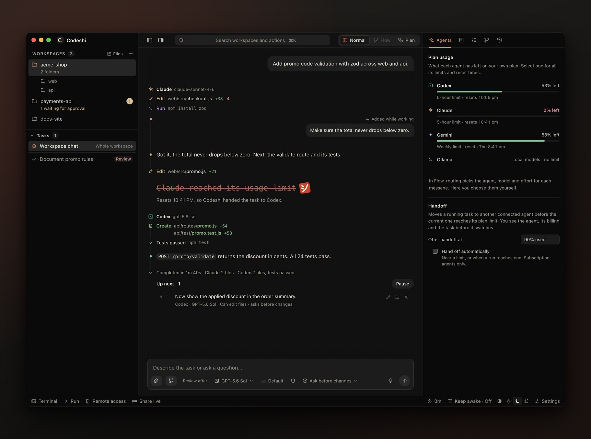
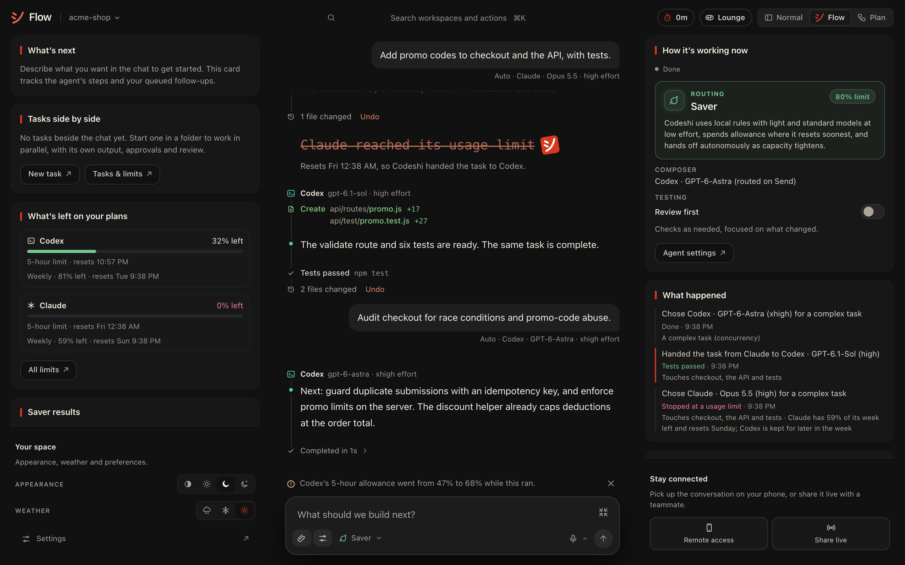
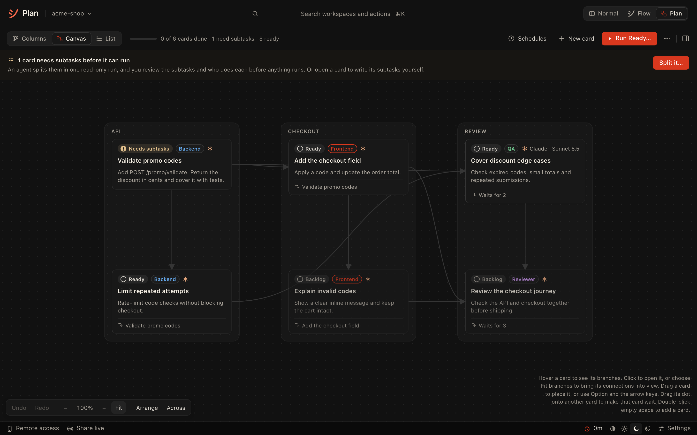
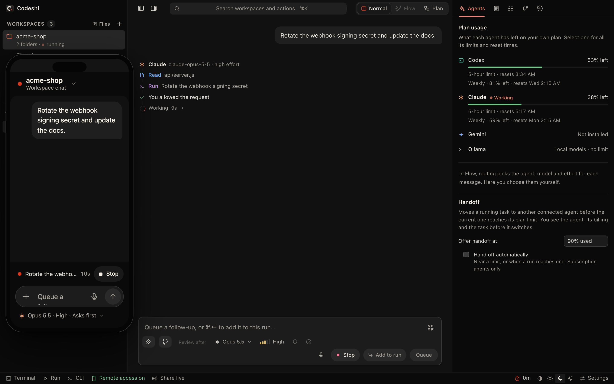

<h1 align="center"><picture><source media="(prefers-color-scheme: dark)" srcset="assets/icon-dark.svg"></picture><br>Codeshi</h1>

<p align="center"><b>Claude Code, Codex, Gemini and local Ollama models in one conversation per project.</b><br>
Switch agents mid-task, hand off at usage limits, run tasks side by side in Git worktrees, and approve from your phone — on the plans you already pay for.</p>

<p align="center"><a href="#install-pre-built-app"><b>Install</b></a> &nbsp;·&nbsp; <a href="#run-from-source"><b>Run from source</b></a> &nbsp;·&nbsp; <a href="#questions"><b>FAQ</b></a> &nbsp;·&nbsp; <a href="https://codeshi.dev"><b>Website &amp; Demos</b></a> &nbsp;·&nbsp; <a href="docs/README.md"><b>Docs</b></a> &nbsp;·&nbsp; <a href="docs/guide.md"><b>User Guide</b></a> &nbsp;·&nbsp; <a href="docs/cli.md"><b>CLI</b></a> &nbsp;·&nbsp; <a href="#contributing"><b>Contribute</b></a></p>

<p align="center"><a href="https://github.com/AhmedNavaz/codeshi/releases/latest"></a>  <a href="https://github.com/AhmedNavaz/codeshi/actions/workflows/ci.yml"></a> <a href="LICENSE"></a> <a href="https://www.patreon.com/17048317/join"></a></p>

<p align="center"><a href="https://codeshi.dev"></a><br><a href="https://codeshi.dev">See interactive walkthroughs, screenshots, and live demos at <b>codeshi.dev</b></a></p>

---

## What is Codeshi?

**Codeshi is a free, open-source desktop app for macOS and Windows (MIT licensed) that puts Claude Code, Codex, Gemini and local Ollama models in one conversation per project**, so you can switch agents mid-task and keep working when one hits its usage limit, on the plans you already pay for.

- **No API markup**: Runs against your existing personal or subscription logins (Claude Code, ChatGPT/Codex, Google/Gemini). API-billed or unconfirmed accounts require explicit confirmation and are never chosen automatically.
- **Local first**: Runs on your computer, reads your local workspace folders, and keeps conversations, memory, board cards, activity, and file checkpoints locally.
- **Multi-agent continuity**: Switch agents mid-task with a lossless brief, hand off automatically near 5-hour, daily, or weekly limits, run tasks side by side in Git worktrees, and have another agent review finished changes read-only.

### What Codeshi doesn't do

- **No hosted service**: Codeshi stores nothing on a cloud server. Away-from-home phone access passes messages through a relay, encrypted on your devices first.
- **No way around usage limits**: Each agent keeps its own subscription caps. When one fills up, Codeshi moves the task to another agent with room or waits for an allowance to reset.
- **No pre-built Linux package yet**: Official downloads target macOS and Windows. Native Linux packaging is help wanted ([#5](https://github.com/AhmedNavaz/codeshi/issues/5)); the automated test suite runs on Linux in CI.

---

## Quickstart

### Install Pre-built App

**macOS** (Apple Silicon or Intel), in Terminal:
```sh
curl -fsSL https://raw.githubusercontent.com/AhmedNavaz/codeshi/main/install.sh | sh
```

macOS builds are signed with a Developer ID certificate and notarized by Apple ([#1](https://github.com/AhmedNavaz/codeshi/issues/1)).

**Windows** (64-bit), in PowerShell:
```powershell
irm https://raw.githubusercontent.com/AhmedNavaz/codeshi/main/install.ps1 | iex
```

Both commands check the release's published SHA-256 checksum before installing. Running the Windows command again also updates an existing installation. Or download zipped builds directly from [Releases](https://github.com/AhmedNavaz/codeshi/releases/latest).

> **The first time you open a Windows browser download:** Codeshi isn't signed for Windows yet, so SmartScreen may say it protected your PC: click **More info**, then **Run anyway** (the PowerShell install command above does not trigger this).

Once installed, Codeshi checks GitHub Releases for updates and updates in place on macOS and Windows after verifying checksums.

### Supported Agents & Requirements

Connect at least one agent using your own login — no API keys or extra subscriptions required:

| Agent | How to connect | Notes |
| :--- | :--- | :--- |
| **Claude Code** | Sign in via official [Claude Code](https://code.claude.com/docs/en/overview) CLI | Runs through Claude Agent SDK + GUI approvals |
| **Codex** | Sign in via official [Codex CLI](https://github.com/openai/codex) | Runs via Codex app-server JSON-RPC |
| **Gemini** | **Settings › Agents & accounts › Install Google connection** | Personal Google accounts via Antigravity ACP (*experimental*); enterprise/API Gemini CLI 0.66.0+ also supported |
| **Local (Ollama)** | Install [Ollama](https://ollama.com/download) + Codex CLI, pull a tool-capable coding model | Runs offline via Codex tool harness; zero cloud plan usage |

*Platforms:* **macOS** (Apple Silicon & Intel) and **Windows** (x64) have pre-built installers and binaries; **Linux** currently requires running from source ([#5](https://github.com/AhmedNavaz/codeshi/issues/5)).

### Run from Source

Codeshi has **no build step** (plain JavaScript ES modules). Running from source requires **Node.js 22.12+**:

```sh
git clone https://github.com/AhmedNavaz/codeshi.git
cd codeshi
npm ci
npm start        # Launches Codeshi Dev in an isolated profile
```

*For browser-only mode without Electron: `npm run web` (serves at `http://127.0.0.1:4318`).*

---

## Three Modes & Core Capabilities

Codeshi gives every workspace three views you can switch between at the top right — **Normal**, **Flow**, and **Plan** *(Experimental)* — all sharing the same permanent conversation and checkpoints.

<table>
  <tr>
    <td width="50%" valign="top">
      <a href="docs/features/flow.webp"></a><br>
      <b>Flow Mode</b> — Replaces side panels with plain-language cards around the chat, routes across <b>Saver</b>, <b>Smart</b>, and <b>Ultra</b>, hands off automatically near limits, and can split multi-part requests into parallel tasks.
    </td>
    <td width="50%" valign="top">
      <a href="docs/features/plan.webp"></a><br>
      <b>The Plan</b> <i>(Experimental)</i> — Columns, dependency <b>Canvas</b>, and <b>Outline</b> beside a dedicated <b>Plan chat</b>. Draft cards from prompts, sketches, or specs (including PDFs on macOS), attach up to six files per card, split major cards into subtasks, run specialist roles with test gates, and keep changed-file diffs in Review &amp; Done.
    </td>
  </tr>
</table>

### Switching, Routing & Context

- **Seamless limit handoffs**: Tracks 5-hour, daily, and weekly allowances. Near a limit, Codeshi offers a handoff with full brief context (or switches automatically in Flow at 80% / 90% / 95% for Saver / Smart / Ultra), or waits and resumes with **Continue when a limit resets**.
- **Automatic context refresh**: Keeps your full workspace chat saved while automatically starting a fresh native agent session between turns when context reaches its target. Inspect readings, approaching dots, or confirm **Refresh on next send** from the **Compact context** icon without running an extra model summary ([Guide](docs/guide.md#workspaces-accounts-and-switching)).
- **Smart results** *(Experimental)*: Computes locally what **Saver**, **Smart**, and **Ultra** routing used and verified from your saved tasks — with zero model calls ([Guide](docs/guide.md#models-runs-git-and-usage)).
- **Offline local models**: Continue or start tasks on downloaded tool-capable Ollama models through the Codex CLI tool harness with zero cloud plan usage ([Guide](docs/guide.md#local-models)).

### Parallel Work, Review & Preview

- **Tasks side by side** *(Experimental)*: Run multiple tasks concurrently in the same workspace. Every task in a Git repository with at least one commit always runs in its own isolated Git worktree (copy-on-write `node_modules` clone, omitting `.env`), so the **Workspace chat** stays free. Enforces per-folder edit boundaries, opens task files from chat, and merges back with **Review and merge** or **Resolve with an agent** ([Guide](docs/guide.md#models-runs-git-and-usage)).
- **Run and review your project** *(Experimental)*: Have an agent prepare a launch map (`.codeshi/preview.json`), start services in dependency order from a Flow card, inspect startup logs, and open previews ([Guide](docs/guide.md#models-runs-git-and-usage)).
- **Design notes, Sketch a page & Point and tell** (Desktop): Click elements or drag boxes on your running app's preview—or lay out a page that doesn't exist yet with **Sketch a page**—and send numbered notes and screenshots into your message box or onto the Plan with **Add to Plan** ([Guide](docs/guide.md#models-runs-git-and-usage)).
- **Schedules**: Schedule Ready or Done cards, ticked Ready cards in Flow, or standalone prompts (with a chosen agent or on **Auto** in Flow under a shared usage limit) once, daily, on weekdays, or weekly in local time. Stays in the menu bar / notification area when scheduled, supports **Open at login**, and catches missed runs ([Guide](docs/guide.md#models-runs-git-and-usage)).
- **Interactive approvals & cross-agent review**: Default **Ask before changes** allows reads and pauses edits, installs, commands, and network access (once, for this run, or always in this workspace). Request read-only **Cross-agent code review** from another provider against selected file snapshots and send findings back as fixes ([Guide](docs/guide.md#cross-agent-review)).

### Phone, Tracking, Terminal & Sharing

<p align="center"><a href="docs/features/remote.webp"></a></p>

- **Remote access** *(Experimental)*: Scan a QR code to follow live runs, approve commands, answer questions, dictate prompts, and get lock-screen notifications from a phone browser — direct over Wi-Fi or end-to-end encrypted away from home ([Guide](docs/guide.md#remote-access-away-from-home)).
- **Activity & Work time**: Live work timer in the status bar with automatic break, lunch, wrap-up, and sleep reminders. Click it for **Activity**: today's timeline, weekly bars, monthly calendar, token breakdown by agent, and eight local monthly badges ([Guide](docs/guide.md#models-runs-git-and-usage)).
- **While you were away & Menu bar status**: Return after two minutes to a local recap (written or read aloud) of finished runs, changed files, and waiting approvals. On macOS, Codeshi's `シ` menu bar item and optional **Progress pill** show live status from other apps ([Guide](docs/guide.md#models-runs-git-and-usage)).
- **The `codeshi` command (CLI) & Terminal**: Interactive terminal session (`codeshi`) and scriptable subcommands (`codeshi run`, `status`, `wait`, `stop`, `continue`, `doctor`, `skills`, `tasks --json`), sharing the window's conversation, plus an in-app **CLI** tab and multi-pane **Terminal** / **Run** panel ([CLI Reference](docs/cli.md)).
- **Checkpoints, Timeline & Git**: Per-run undo/redo, **Timeline** checkpoint restore with conversation rewind, local **Git activity** (including image diffs), staging/commits with your own hooks, and **Open pull request** via `gh` ([Guide](docs/guide.md#models-runs-git-and-usage)).
- **Workspace continuity & collaboration**: **Memory** and native **Skills** across Claude, Codex, and Gemini (**Brief** panel), **New workspace › From GitHub** (via `gh` or **Sign in with GitHub**), on-device **Voice** dictation and Flow voice conversations, [Claude Code & Codex chat import](docs/guide.md#import-claude-code-and-codex-chats), [Move to another computer](docs/guide.md#move-to-another-computer) by `.codeshibackup` file or Wi-Fi, [**Share live**](docs/guide.md#share-live-with-a-teammate) (watch read-only, send messages, or run turns on a teammate's own account with reviewed patches), and [**Ask a Friend**](docs/guide.md#ask-a-friend) patch workflows. See the full [User Guide](docs/guide.md).

---

## The Engine Under the Hood

Codeshi coordinates disparate agent runtimes through a local Node.js orchestration server:

- **Unified Agent Protocol (`src/providers.mjs`)**: Normalizes the Claude Agent SDK, Codex app-server JSON-RPC, Gemini/Antigravity ACP, and local Ollama into one event bus for streaming steps, approvals, questions, and diffs.
- **Lossless Context Rollover (`src/task-context.mjs`)**: Builds a bounded brief from active file diffs, workspace instructions, user decisions, and unblocked tasks without relying on model-generated summaries.
- **Shadow Git Checkpoints & Mutation Leases (`src/checkpoints.mjs`, `src/mutation-lock.mjs`)**: Runs operate under filesystem leases with private Git snapshots before and after each run for rollback and conflict-safe worktrees.
- **Smart Spendability Routing (`src/routing-assessment.mjs`)**: Routes prompts across **Saver**, **Smart**, and **Ultra** using request complexity, rated model tiers, and live quota spendability across every active window.
- **Autonomous Verification Loops (`src/run-checks.mjs`, `src/agent-review.mjs`)**: Runs your workspace's configured test command and independent read-only cross-agent reviews against finished changes.

See [docs/README.md](docs/README.md) and [docs/architecture.md](docs/architecture.md) for documentation index, service boundaries, and module ownership.

---

## Questions

### How do I keep working in Claude Code when I hit the usage limit?
Codeshi tracks your 5-hour, daily and weekly allowances. Near a limit it offers a handoff to another agent with the full brief, or waits and resumes with **Continue when a limit resets**. See [Switching, Routing & Context](#switching-routing--context) and the [guide](docs/guide.md#workspaces-accounts-and-switching).

### How do I keep going in Codex when I hit its usage limit or weekly cap?
Codex limits work the same way: Codeshi tracks the 5-hour and weekly allowances and offers a handoff before you run out, or switches automatically in Flow. See [Switching, Routing & Context](#switching-routing--context) and the [guide](docs/guide.md#workspaces-accounts-and-switching).

### How do I move a task from Claude Code to Codex (or back) without re-explaining everything?
When you switch agents, Codeshi builds a bounded brief from the active file diffs, workspace instructions, your decisions and unblocked tasks, so the next agent starts with the context. It doesn't rely on model-generated summaries. See [The Engine Under the Hood](#the-engine-under-the-hood) and the [guide](docs/guide.md#workspaces-accounts-and-switching).

### Can I run several coding agents on one repository at the same time?
Yes. **Tasks side by side** run in the same workspace, and every task in a Git repository with at least one commit works in its own Git worktree so edits don't collide and the Workspace chat stays free. You merge back with **Review and merge**. See [Parallel Work, Review & Preview](#parallel-work-review--preview) and the [guide](docs/guide.md#models-runs-git-and-usage).

### Can I use Claude Code and Codex together in one conversation?
Yes. Each workspace keeps one permanent conversation shared across the Claude Code, Codex and Gemini CLIs and local Ollama models. See [What is Codeshi?](#what-is-codeshi).

### Can I use local models (Ollama) with a coding agent, and is it free?
Yes. Codeshi runs downloaded, tool-capable Ollama models through the Codex CLI tool harness, with no cloud subscription or plan usage. See [Supported Agents & Requirements](#supported-agents--requirements), the [guide](docs/guide.md#local-models) and [Run from Source](#run-from-source) for setup.

### Can I approve what a coding agent does from my phone?
Yes. Scan a QR code to follow live runs, approve commands and answer questions from a phone browser. It's end-to-end encrypted away from home, or direct over the same Wi-Fi. See [Phone, Tracking, Terminal & Sharing](#phone-tracking-terminal--sharing) and the [guide](docs/guide.md#remote-access-away-from-home).

### Does it work with my existing Claude or ChatGPT subscription, with no API keys?
Yes. Codeshi runs against your existing personal or subscription logins and supplies no API keys of its own. API-billed or unconfirmed accounts need explicit confirmation and are never chosen automatically. See [What is Codeshi?](#what-is-codeshi).

### Is there a free open-source alternative to a paid multi-agent coding app, and what does it cost?
Codeshi is free and open source under the MIT license. You pay only for the agent plans you already use. See [What is Codeshi?](#what-is-codeshi) and [License](#license).

### How do I install it on macOS or Windows, and is there a Linux version?
On macOS or Windows, run the one-line install command in [Install Pre-built App](#install-pre-built-app). There is no pre-built Linux package yet; native Linux packaging is help wanted ([#5](https://github.com/AhmedNavaz/codeshi/issues/5)), and the test suite already runs on Linux in CI. See [Contributing](#contributing).

### Why does Windows warn me when I open it, and is it safe?
macOS builds are signed and notarized by Apple. Windows builds aren't signed yet, so SmartScreen asks you to confirm a browser download once (the PowerShell install command doesn't trigger the warning). See the first-open steps in [Install Pre-built App](#install-pre-built-app) and [Limitations](docs/guide.md#limitations) in the guide.

### Can one agent review another agent's code?
Yes. Request a read-only review from another provider against selected file snapshots, then send chosen findings back as a fix prompt. See [Parallel Work, Review & Preview](#parallel-work-review--preview) and the [guide](docs/guide.md#cross-agent-review).

### How do I stop an AI coding agent from running commands or editing files without asking?
The default **Ask before changes** lets reads proceed and pauses edits, installs, commands and network access for your confirmation. See [Parallel Work, Review & Preview](#parallel-work-review--preview) and the [guide](docs/guide.md#permission-controls-and-tool-approvals).

### Does it keep my code and chats on my computer? Is anything sent to a server?
Codeshi runs on your computer and stores journals, memory, board cards, activity and file checkpoints locally. Remote access from a phone is end-to-end encrypted away from home. See [What is Codeshi?](#what-is-codeshi) and [Saved data and migration](docs/guide.md#saved-data-and-migration) in the guide.

### How do I import my existing Claude Code or Codex chats?
Open **Previous chats** from the search bar (⌘K) or the **File** menu, pick conversations from either agent, review them and confirm **Merge conversations**. Nothing is selected or merged automatically. See [Import Claude Code and Codex chats](docs/guide.md#import-claude-code-and-codex-chats).

---

## Status & Experimental

Codeshi is early and changes quickly. Features covered by automated tests still undergo verification on real setups — see [Final checks](ROADMAP.md#final-checks) in `ROADMAP.md` and open reports under the [`bug` label](https://github.com/AhmedNavaz/codeshi/labels/bug).

- **Toggleable in `Settings › Experimental`**: Five newer surfaces (**Remote access**, **Plan**, **Run and review your project**, **Smart results**, and **Tasks side by side**) can each be turned on or off from **Settings › Experimental**. All are on by default except **Smart results**.
- **Awaiting real-world verification or relying on experimental upstream APIs**:
  - **Gemini (Antigravity ACP & Gemini CLI)**: personal Google accounts run through the pinned Antigravity ACP runtime; read-only background reviews still use Claude or Codex.
  - **Flow message splits**: automatically splitting a multi-part Smart or Ultra prompt into parallel tasks and merging/reviewing the combined result.
  - **Paid API task limits ([#87](https://github.com/AhmedNavaz/codeshi/issues/87))**: time, token, and API spend caps are tested with simulated providers and not yet verified on a real pay-per-use account.
  - **Move over your network ([#160](https://github.com/AhmedNavaz/codeshi/issues/160))**: tested with both sides on one computer, awaiting verification between two computers on Wi-Fi.
  - **Windows in-app updates ([#163](https://github.com/AhmedNavaz/codeshi/issues/163))**: tested with macOS stand-ins for the PowerShell updater, awaiting verification on a real Windows PC.
  - **Claude plan usage**: read from an experimental Claude Agent SDK call and shown as unavailable if a future SDK removes it.

See [Limitations](docs/guide.md#limitations) and [Final checks](ROADMAP.md#final-checks) for details.

---

## Roadmap

Current **Now** priorities from [ROADMAP.md](ROADMAP.md):

| # | Feature | What's left | Issue |
| :---: | :--- | :--- | :--- |
| 1 | **Notarized macOS builds** | Downloads that open without a security prompt, with notification banners. Waiting on an Apple Developer account | [#1](https://github.com/AhmedNavaz/codeshi/issues/1) |
| 2 | **One Plan** | Live checks of drafting cards and running a plan with several agents | [#162](https://github.com/AhmedNavaz/codeshi/issues/162) |
| 3 | **Flow manages a whole outcome** | Live checks of a handoff between real accounts and of a split finished with real agents | [#107](https://github.com/AhmedNavaz/codeshi/issues/107) |
| 4 | **One routing policy for the whole task** | Live check of Flow handoffs between real accounts, measured model ratings, context-size checks against a model, and automatic fallback to a local model | [#12](https://github.com/AhmedNavaz/codeshi/issues/12) |
| 5 | **Specialist roles** | Showing on the Plan which cards need another check after a contract or schema changes, and a measured comparison with one agent | [#89](https://github.com/AhmedNavaz/codeshi/issues/89) |

See [ROADMAP.md](ROADMAP.md) for **Next**, **Later**, **Final checks**, **Ongoing checks**, **Exploring**, and **Recently shipped**, and [CHANGELOG.md](CHANGELOG.md) for release-by-release notes.

---

## Contributing

Codeshi is open source under the [MIT License](LICENSE) with no CLA. The best way to help right now is to try it on a real project and report what breaks ([report a bug](https://github.com/AhmedNavaz/codeshi/issues/new?template=bug_report.yml) or [share design feedback](https://github.com/AhmedNavaz/codeshi/issues/new?template=ux_feedback.yml)).

Where help is wanted:
- **Interface and docs**: fix interface details and clarify how features work in the [User Guide](docs/guide.md).
- **Accessibility and languages**: test with VoiceOver or NVDA on your project, or contribute a UI translation ([Translations](CONTRIBUTING.md#translations)).
- **Linux packaging**: help package native Linux builds; the test suite already runs on Linux in CI ([#5](https://github.com/AhmedNavaz/codeshi/issues/5)).
- **Checks on real devices**: test paid API task limits ([#87](https://github.com/AhmedNavaz/codeshi/issues/87)), moving between computers over Wi-Fi ([#160](https://github.com/AhmedNavaz/codeshi/issues/160)), or Windows in-app updates ([#163](https://github.com/AhmedNavaz/codeshi/issues/163)) and report the result.

Links for contributors:
- Open issues labelled [`good first issue`](https://github.com/AhmedNavaz/codeshi/labels/good%20first%20issue) or [`help wanted`](https://github.com/AhmedNavaz/codeshi/labels/help%20wanted)
- Setup instructions, targeted tests, and codebase map in [CONTRIBUTING.md](CONTRIBUTING.md), [docs/README.md](docs/README.md), and [docs/architecture.md](docs/architecture.md)
- Questions and ideas in [GitHub Discussions](https://github.com/AhmedNavaz/codeshi/discussions)
- Run the test suite (uses mock providers, no agent logins required):
  ```sh
  npm test
  ```

*Security disclosures: report vulnerabilities privately according to [SECURITY.md](SECURITY.md).*

---

## Support

Codeshi is free and open source, under the MIT license. If it saves you time, you can support ongoing development:

- [Patreon](https://www.patreon.com/17048317/join)

Funding goals:

- Code signing for the macOS and Windows builds, which removes the first-open warnings described under [Install Pre-built App](#install-pre-built-app).
- Usage costs for testing against the real Claude Code, Codex and Gemini CLIs.
- Maintainer time for issues, reviews and the [roadmap](ROADMAP.md).

---

## License

[MIT License](LICENSE) · Built independently. Not affiliated with or endorsed by Anthropic, OpenAI, or Google.
