<p align="center"></p>

<h1 align="center">Throughline</h1>

<p align="center">Your control plane for agentic development.<br>Carry Claude Code, Codex, Gemini and local models through one continuous project thread.</p>

<p align="center"><a href="https://github.com/AhmedNavaz/throughline/actions/workflows/ci.yml"></a> <a href="https://github.com/AhmedNavaz/throughline/releases/latest"></a> <a href="LICENSE"></a> <a href="https://www.patreon.com/17048317/join"></a></p>

<p align="center">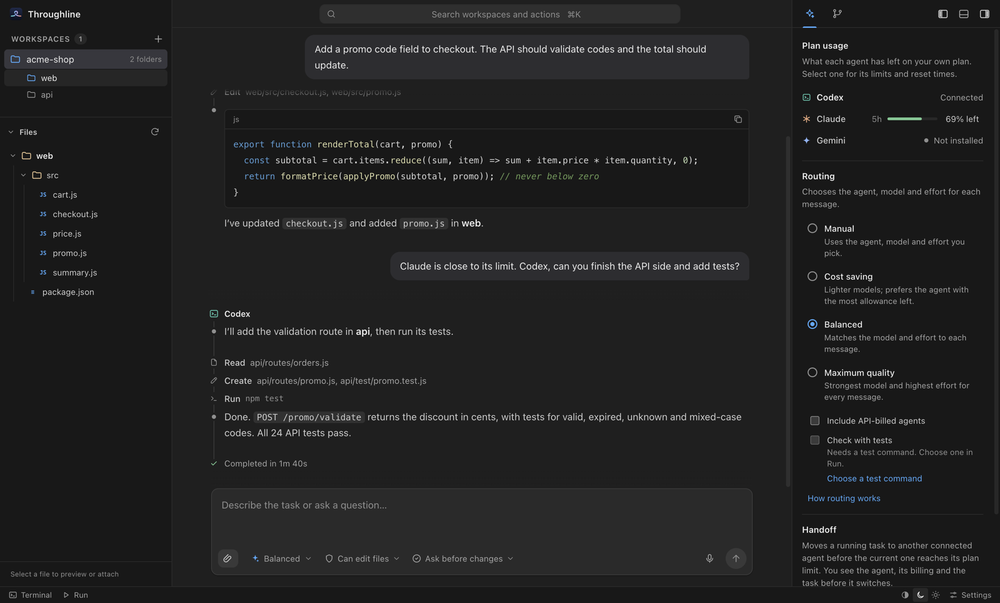</p>

Throughline is an open-source desktop control plane for agentic development. It brings Claude Code, Codex, Gemini through Google Antigravity and downloaded Ollama coding models into a unified workspace for multi-agent orchestration, persistent project context, and human-in-the-loop collaboration. It runs the agents you already have installed, on your own accounts and subscriptions.

## What you can do

<table>
<tr>
<td colspan="2" valign="top">

<h3>See what your agents are doing from the menu bar</h3>
<p>Keep working in your editor or browser while agents run. The Throughline icon in your Mac's menu bar tells you when something needs you, like an approval or failing tests, and otherwise what the agent is doing right now. Click it to see every busy project at a glance and jump straight to the one waiting on you. Alerts can also pop up at the top of the screen if you turn them on. Your commands, code and file names stay inside the app.</p>
</td>
</tr>
<tr>
<td width="50%" valign="top">
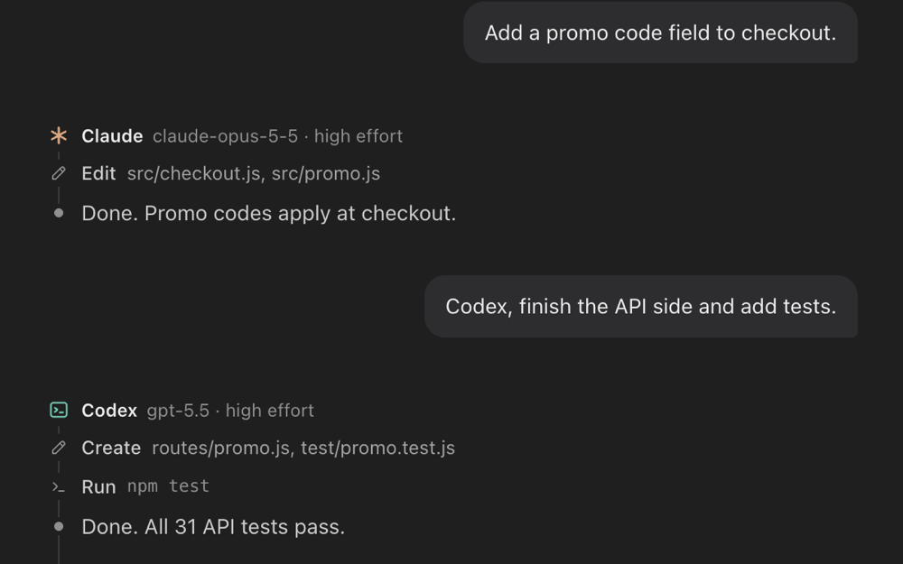
<h3>Switch agents without starting over</h3>
<p>Claude Code, Codex, Gemini and local models work in the same conversation for each project. If one gets stuck or runs out of usage, switch to another mid-task and it carries on from everything said so far.</p>
</td>
<td width="50%" valign="top">
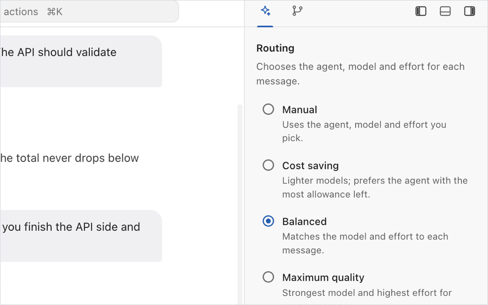
<h3>Let Throughline pick the model</h3>
<p>For each message, it chooses the agent, the model and how hard it should think: a light model for a typo, the strongest one for a refactor. You see its choice and why before you send. Turn on test checks and it runs your tests after each change; if they fail, it tries once more with a stronger model or more thinking.</p>
</td>
</tr>
<tr>
<td width="50%" valign="top">
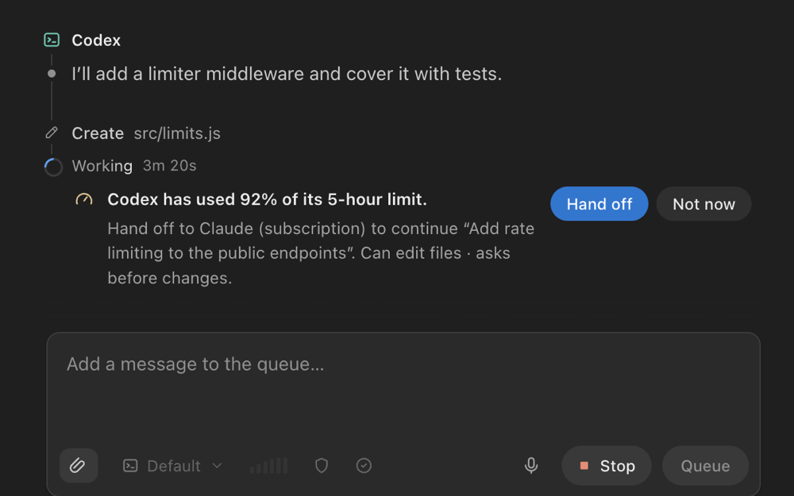
<h3>Keep going when an agent hits its limit</h3>
<p>When an agent gets close to its plan's usage limit, Throughline offers to hand the task to another agent that still has room. Before anything switches, you see which agent and model would take over and whether it's covered by your subscription.</p>
</td>
<td width="50%" valign="top">
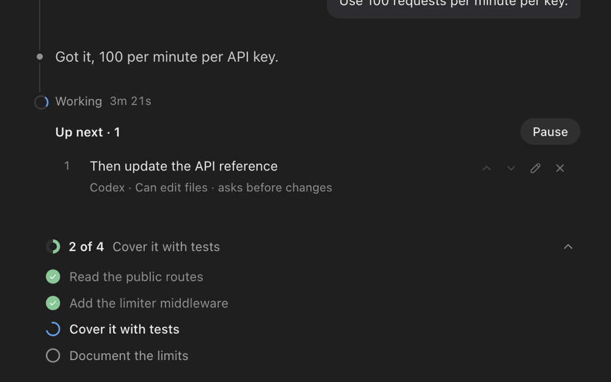
<h3>Line up work and guide it as it goes</h3>
<p>Queue your next prompts so they run one after another. Add a note to the task that's running without stopping it, and follow the agent's plan as a checklist that ticks off as it works.</p>
</td>
</tr>
<tr>
<td width="50%" valign="top">
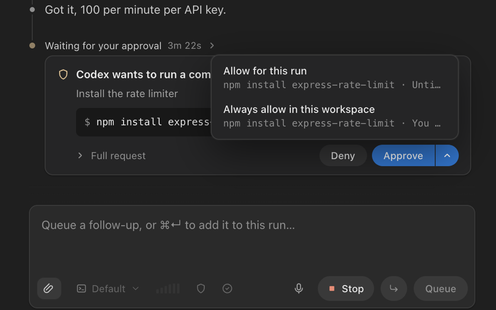
<h3>You decide what agents can change</h3>
<p>Agents can look around your project freely, but anything that could change it asks you first. Allow it once, for the rest of the task, or always in this project.</p>
</td>
<td width="50%" valign="top">
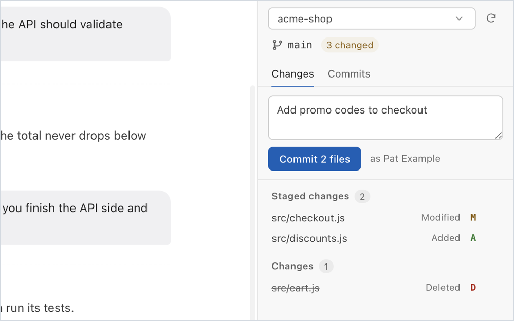
<h3>Review and commit in one place</h3>
<p>See every changed file with its diff, stage what you've checked, and commit under your own Git name with your project's usual commit checks. Throughline never pushes for you.</p>
</td>
</tr>
<tr>
<td width="50%" valign="top">
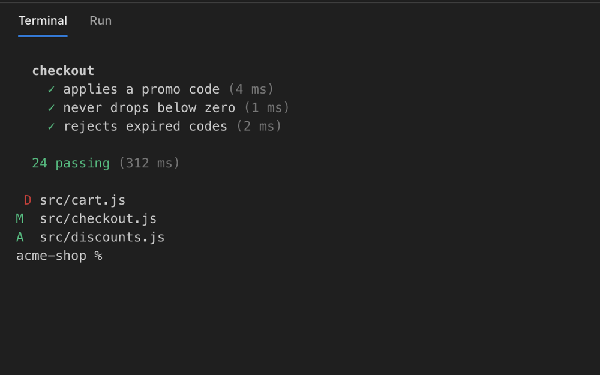
<h3>A terminal for each project</h3>
<p>Your own shell in a panel below the conversation. It keeps running when you hide it or switch projects, so your dev server stays up while agents work.</p>
</td>
<td width="50%" valign="top">
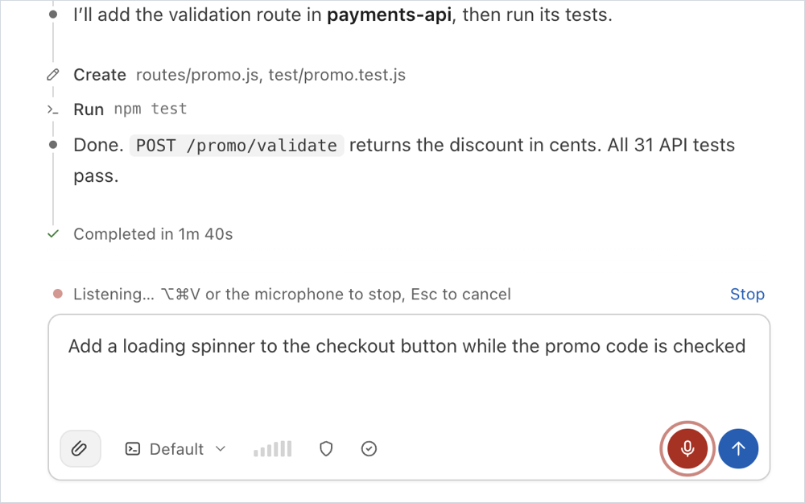
<h3>Talk instead of typing</h3>
<p>On a Mac, say what you want and your words appear in the message box, ready to check and send. Your voice is recognized on your Mac and never leaves it. When the task is done, Throughline reads you a short summary.</p>
</td>
</tr>
<tr>
<td width="50%" valign="top">
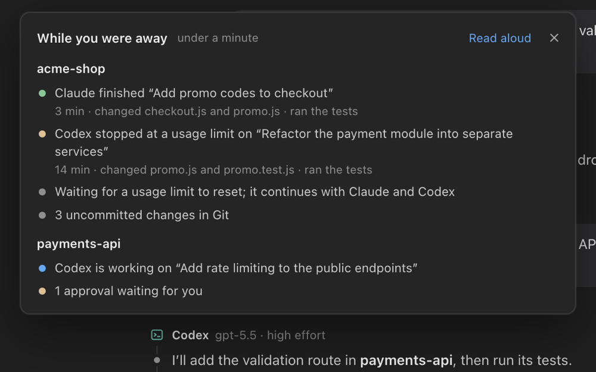
<h3>Catch up when you come back</h3>
<p>Step away, and when you return a short summary shows for each project: what finished, which files changed, and what's waiting for you, like an approval or a queued prompt. It can read it aloud too.</p>
</td>
<td width="50%" valign="top">
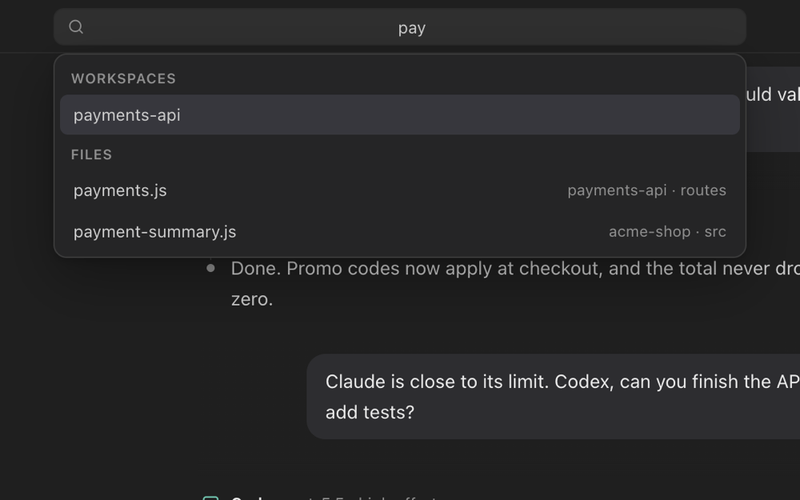
<h3>Find anything with ⌘K</h3>
<p>One search bar for your projects, the files in all of them, and the app's actions.</p>
</td>
</tr>
</table>

<details>
<summary><b>Everything else Throughline does</b></summary>

**Multi-agent orchestration and continuity**

- One permanent conversation per project, shared by all its folders, such as frontend, backend and website.
- Switch between Claude Code, Codex and Gemini mid-task, for example when one hits its usage limit. The next agent picks up the shared context.
- When a usage limit stops a run, continue with any agent and model, or let the task wait and continue on whichever agent has room first once a limit resets.
- **Continue locally** with a downloaded Ollama coding model when cloud allowances run out. The same project thread carries over, using Codex's workspace tools and approvals with separate local-model attribution. See [setup and limits](docs/guide.md#local-models).
- Choose cloud agents and downloaded local models in one searchable picker, then use the same composer.
- Choose the model, reasoning effort and access (read only or can edit files) for every message, or let **Routing** pick the agent, model and effort for each one in Cost saving, Balanced or Maximum quality mode. It shows its choice and the reason before you send, and uses only your subscriptions unless you allow API billing. With **Check with tests**, it runs your Test command after each change and, if the tests fail, retries once a step up.
- **Handoff**: before a usage limit stops a run, Throughline offers to move the task to an agent with room left, showing its model, billing and the task first.
- Queue prompts to run one after another, or add a note to the run that is working without stopping it. When an agent plans in steps, its plan shows as a live to-do list.
- Approve agent actions in the app and follow each run live: current step, tool calls, elapsed time and token counts. **Ask before changes** lets reading the workspace run without approval and asks before edits, installs, scripts or network access. Allow an exact action for the run or remember it for the workspace, with rules you can review and revoke.
- When you are in another app, the Dock and a notification show what finished or needs your approval, and the sidebar marks workspaces that are waiting for you. On macOS, the menu bar shows what's working and what needs you, with optional alerts near the top of the screen.
- Run agents in several workspaces at once; the sidebar shows which ones are busy.
- Find earlier messages and code with Cmd/Ctrl+F, highlighted matches and next/previous navigation.
- Get a second opinion with **Review**: a background agent checks a saved snapshot of selected changes in a side panel while you continue the next task. Findings become outdated when those files change.

**Execution visibility and developer controls**

- A search bar (⌘K) for workspaces, files in every workspace and actions, a side panel for Agents and Git, and resizable sections you can show or hide.
- Git activity for each folder: changed files with diffs, and recent commits. Stage files and commit from the panel with your own identity and the project's commit hooks; Throughline never pushes.
- **While you were away**: come back to a short recap of what ran, what changed and what is waiting in each workspace, written or read aloud.
- **Voice** on macOS: speak a message instead of typing it, recognized on your Mac so the audio never leaves it, and hear a short summary when the run finishes.
- A terminal for each workspace in a bottom panel: your own shell in the folder you choose, kept running while the panel is hidden or you switch workspaces.
- A file browser with syntax-highlighted previews. Attach files and images by clicking, dragging or pasting.
- Plan usage for Claude Code and Codex in the status bar, with reset times, plus per-run context usage when reported.
- Keep awake: your computer stays awake while agents are working or waiting for a usage limit to reset, and sleeps normally once they finish.
- Native desktop menus for workspaces, agents, conversation search, appearance and Help, with keyboard shortcuts and current selections.
- Updates from inside the app on macOS: one click downloads the new version, checks it against its published checksum, and Throughline restarts into it once no agent is working.

**Context portability and human collaboration**

- Import Claude Code and Codex chats from any project, merged in time order.
- Export a conversation file for another Throughline user, with secrets and local paths removed.
- **Ask a Friend** prepares a help request from your current task and recent conversation. Optionally include changed files, review the preview, then export it or create a private link; returned patches require your review.

**A local workspace, powered by your accounts**

- System appearance alongside explicit Dark and Light themes, keyboard shortcuts, Markdown replies with highlighted code and copy buttons, and a short setup guide.
- Runs official Claude Code, Codex and Google Antigravity integrations on your own accounts. Gemini connects through Antigravity ACP with Google sign-in; Gemini CLI remains an advanced API-key/enterprise option. It ships no API keys and adds no model service of its own.

</details>

## Install

**macOS**, in Terminal:

```sh
curl -fsSL https://raw.githubusercontent.com/AhmedNavaz/throughline/main/install.sh | sh
```

**Windows**, in PowerShell:

```powershell
irm https://raw.githubusercontent.com/AhmedNavaz/throughline/main/install.ps1 | iex
```

This installs the latest release for your Mac (Apple Silicon or Intel) or your Windows PC (64-bit) after checking its published checksum. On Windows it goes in your user folder (`%LOCALAPPDATA%\Programs\Throughline`) with a Start menu shortcut, and running the command again updates it. You also need at least one supported agent installed and signed in: [Claude Code](https://code.claude.com/docs/en/overview), [Codex CLI](https://github.com/openai/codex) or connect **Gemini with Google Antigravity** from Settings: **Install Google connection**, then **Connect account**. The download comes from Google and its checksum is verified before installation.

<details>
<summary>Other ways to install</summary>

**Download the app.** Get the zip for your Mac from [Releases](https://github.com/AhmedNavaz/throughline/releases/latest) and move **Throughline** to Applications. The app is not notarized by Apple yet, so the first time you open a browser download macOS says it cannot verify the developer: open **System Settings › Privacy & Security** and click **Open Anyway**. If macOS says the app is damaged, run `xattr -cr /Applications/Throughline.app`.

**Download for Windows.** Get the Windows zip from [Releases](https://github.com/AhmedNavaz/throughline/releases/latest), unzip it anywhere and open **Throughline.exe** in the **Throughline** folder. The app is not signed yet, so Windows may say it protected your PC: click **More info**, then **Run anyway**. Installing the Google connection from Settings is not available on Windows yet; use Claude Code or the Codex CLI.

**Run from source** with Node.js 22.12 or later:

```sh
git clone https://github.com/AhmedNavaz/throughline.git
cd throughline
npm ci
npm start
```

</details>

## How it works

1. **Create a workspace** and add your project's folders.
2. **Pick Claude, Codex or Gemini** in the composer, choose the model and send. Switch agents whenever you like; the next one receives the shared conversation as context.
3. **Bring people and history in.** After opening a workspace, review the previous chats found for its folders, or use **Previous chats** to select and merge Claude Code and Codex conversations. **Export** hands a conversation to someone else, and **Ask a Friend** brings back a patch you review.

Inference starts only when you explicitly send a task, continue one or start a review. Runs use your installed tools and connected accounts, or a downloaded model through **Continue locally**. The [guide](docs/guide.md) covers each feature in detail, including limits and what is stored where.

## Roadmap

Next up: notarized macOS builds, automatic updates, a queue of prompts that run as usage limits allow, Linux builds, and more agents and models such as Grok and DeepSeek. Further out: voice mode (say what you want, hear a short summary of what changed), automatic model and effort choice for each request, live progress in your Mac's menu bar or notch, and agents that review each other's work. See [ROADMAP.md](ROADMAP.md) for what has shipped and the full plan.

## Support Throughline

If Throughline helps your work, you can [support its development on Patreon](https://www.patreon.com/17048317/join). Sponsorship helps fund maintenance, fixes and new features.

## Contributing

Start with the [project map](CONTRIBUTING.md#project-map): `src/` contains the local backend, `desktop/` the Electron shell, `public/` the interface and `sharing/` the optional link service.

The most helpful thing you can do right now is use Throughline and tell us what you find: [report a bug](https://github.com/AhmedNavaz/throughline/issues/new?template=bug_report.yml) or [share design feedback](https://github.com/AhmedNavaz/throughline/issues/new?template=ux_feedback.yml). Code contributions are welcome too; [CONTRIBUTING.md](CONTRIBUTING.md) explains the setup, maps the codebase and lists where to start. Please report vulnerabilities privately as described in [SECURITY.md](SECURITY.md).

## License

[MIT](LICENSE). Throughline is an independent project, not affiliated with or endorsed by Anthropic, OpenAI or Google. Claude, Claude Code, Codex, Gemini and related names are trademarks of their respective owners.
