<p align="center">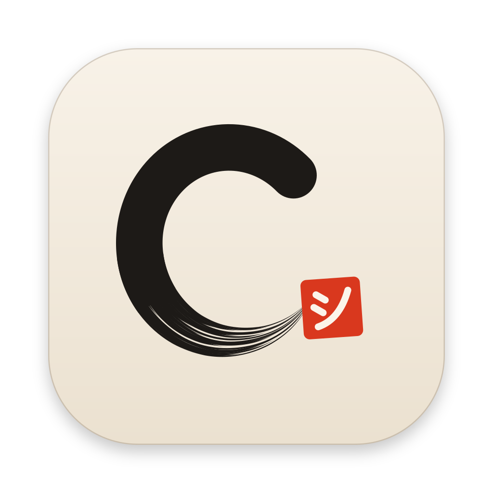</p>

<h1 align="center">Throughline</h1>

<p align="center"><b>Claude Code, Codex, Gemini and local models in one conversation.</b><br>
Switch agents mid-task, keep going when one hits its limit, and use the plans you already pay for.</p>

<p align="center"><a href="#install"><b>Install</b></a> &nbsp;·&nbsp; <a href="docs/guide.md"><b>Guide</b></a> &nbsp;·&nbsp; <a href="ROADMAP.md"><b>Roadmap</b></a> &nbsp;·&nbsp; <a href="CONTRIBUTING.md"><b>Contribute</b></a></p>

<p align="center"><a href="https://github.com/AhmedNavaz/throughline/releases/latest"></a>  <a href="https://github.com/AhmedNavaz/throughline/actions/workflows/ci.yml"></a> <a href="LICENSE"></a> <a href="https://www.patreon.com/17048317/join"></a></p>

<p align="center">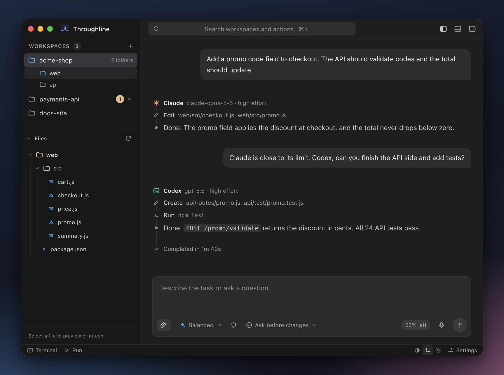</p>

Every coding agent runs out of usage at some point, and moving to another one usually means explaining your project all over again. Throughline gives each project one permanent conversation that all your agents share. Claude can start a task, Codex can finish it, and a model on your own machine can take over when both are out, each picking up from everything said and done so far.

It's a free, open-source desktop app for multi-agent coding on macOS and Windows. It runs the official Claude Code, Codex and Gemini integrations, signed in with your own accounts: no API keys, and no extra subscription.

## What makes it different

### Keep working when an agent hits its limit

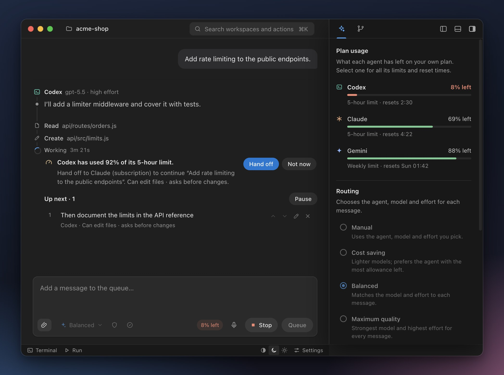

Throughline keeps an eye on each agent's plan usage. Before one runs out mid-task, it offers to hand the task to an agent that still has room, and shows you who takes over and how it's billed before anything switches. If every agent is out, the task waits and carries on with whichever resets first, or you can continue it on a local model.

### Point at what should change

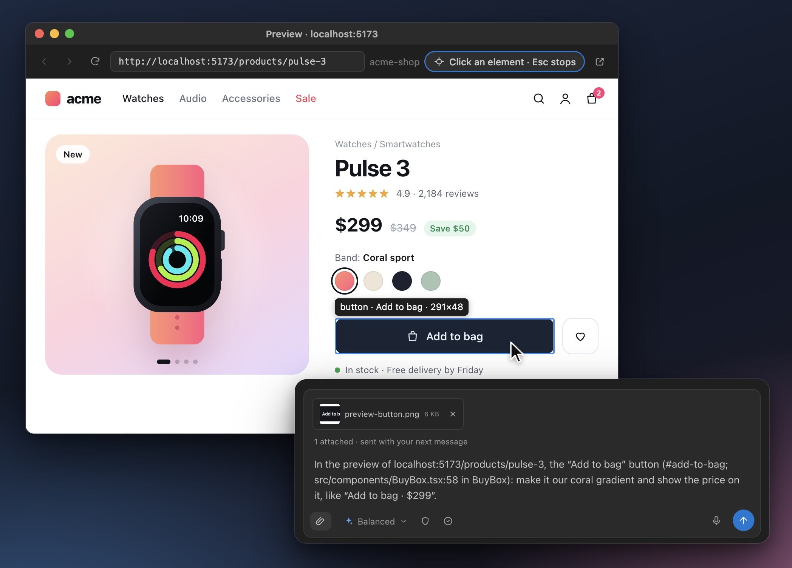

Open your running app in a preview, click the button or section you mean, and say or type the change. The agent gets that element, a screenshot of it and, from your app's development build, where its code is, so it changes the right thing.

### One agent builds, another reviews

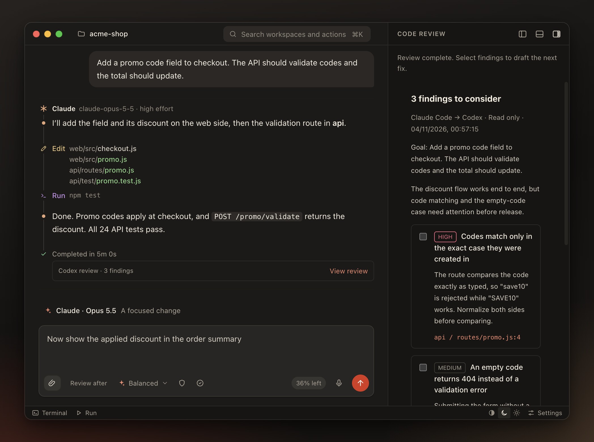

When a task is done, ask the other agent for a second opinion. It reviews a snapshot of the changes, read-only, in a side panel while you carry on with your next prompt. Each finding links to its line, goes out of date if that file changes, and you choose which ones go back to be fixed.

### Know when your agents need you

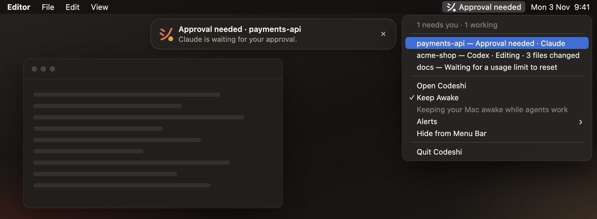

Keep working in your editor or browser. On a Mac, the menu bar shows what every project's agents are doing and flags anything waiting on you, like an approval, with optional alerts at the top of the screen. When you come back, a short recap shows what finished, what changed and what still needs you, and can read it aloud.

## Everything else, built in

<table>
<tr>
<td width="50%" valign="top">
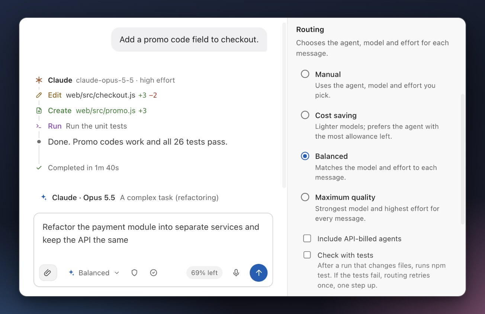
<h3>Routing</h3>
<p>Picks the agent, model and effort for each message, from a light model for a typo to the strongest for a refactor, and shows its choice before you send. It stays on your subscriptions unless you allow API billing.</p>
</td>
<td width="50%" valign="top">
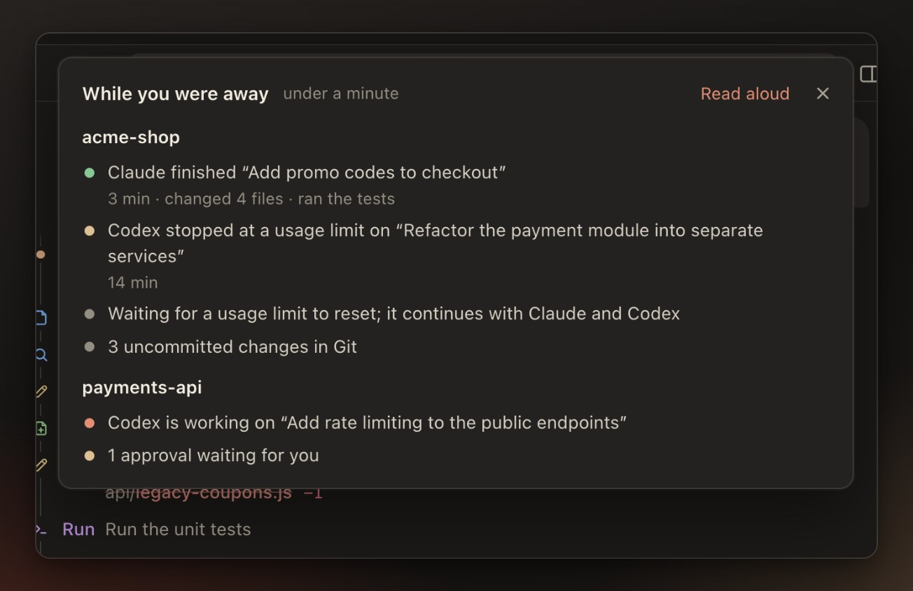
<h3>While you were away</h3>
<p>Come back to a short recap of what finished, what changed and what is waiting in every project. It can read it aloud.</p>
</td>
</tr>
<tr>
<td width="50%" valign="top">
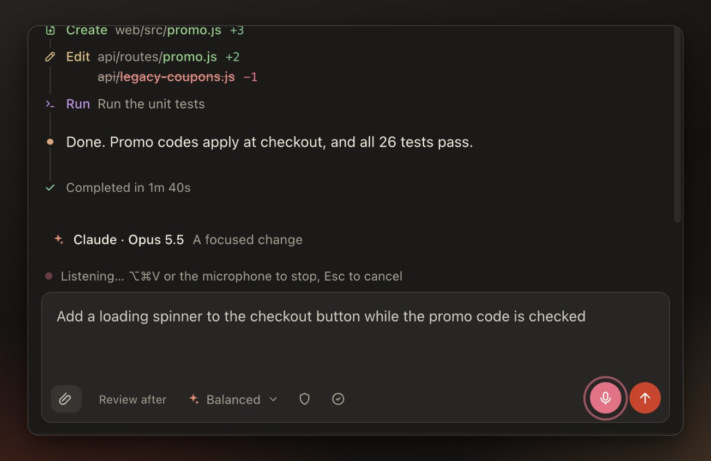
<h3>Voice</h3>
<p>Say what you want instead of typing it. Speech is recognized on your Mac and never leaves it.</p>
</td>
<td width="50%" valign="top">
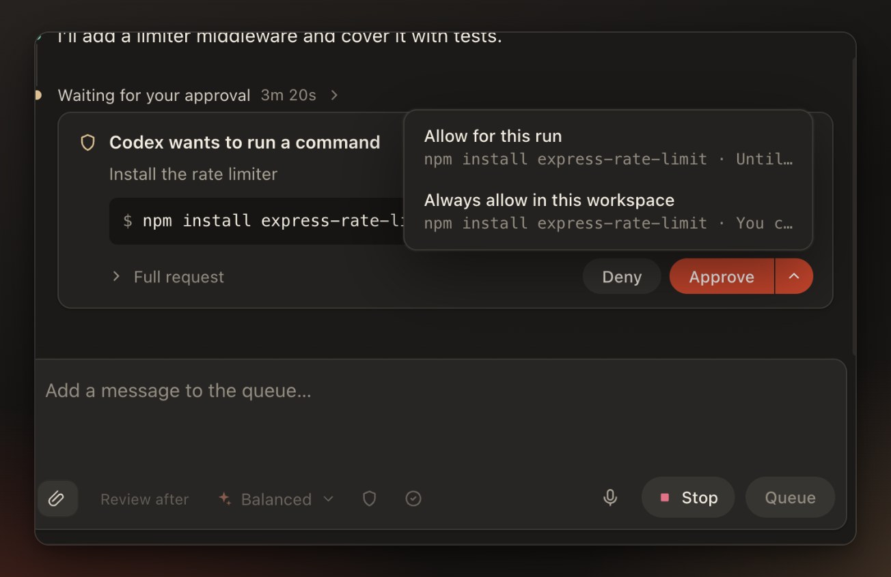
<h3>Approvals your way</h3>
<p>Agents read your project freely and ask before changing it. Allow an exact action once, for the whole task, or always in that project.</p>
</td>
</tr>
<tr>
<td width="50%" valign="top">
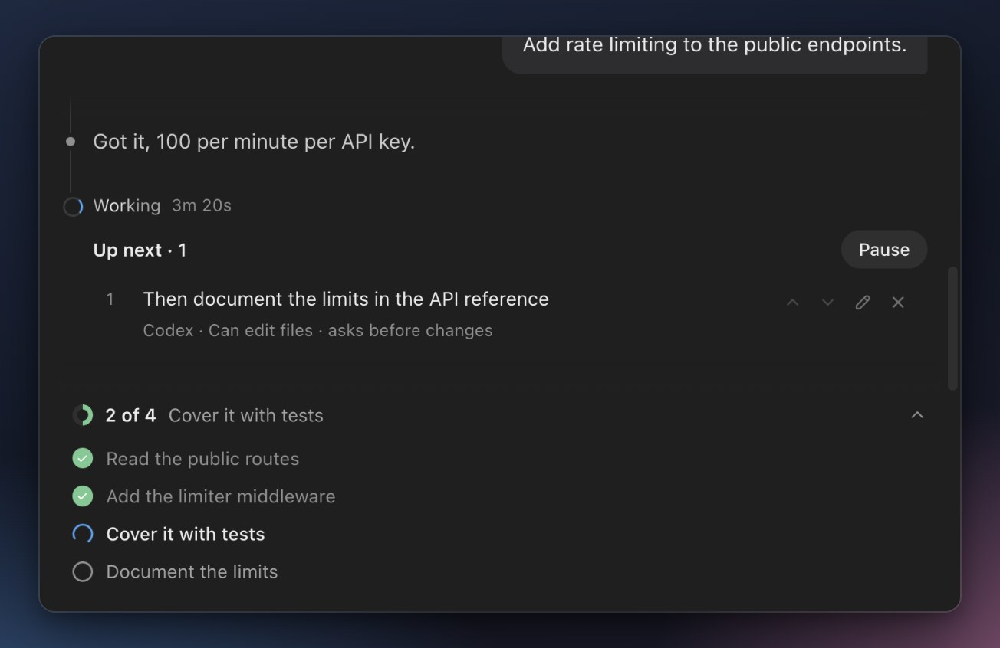
<h3>Queue and steer</h3>
<p>Line up your next prompts, add a note to a running task without stopping it, and follow the agent's plan as a live checklist.</p>
</td>
<td width="50%" valign="top">
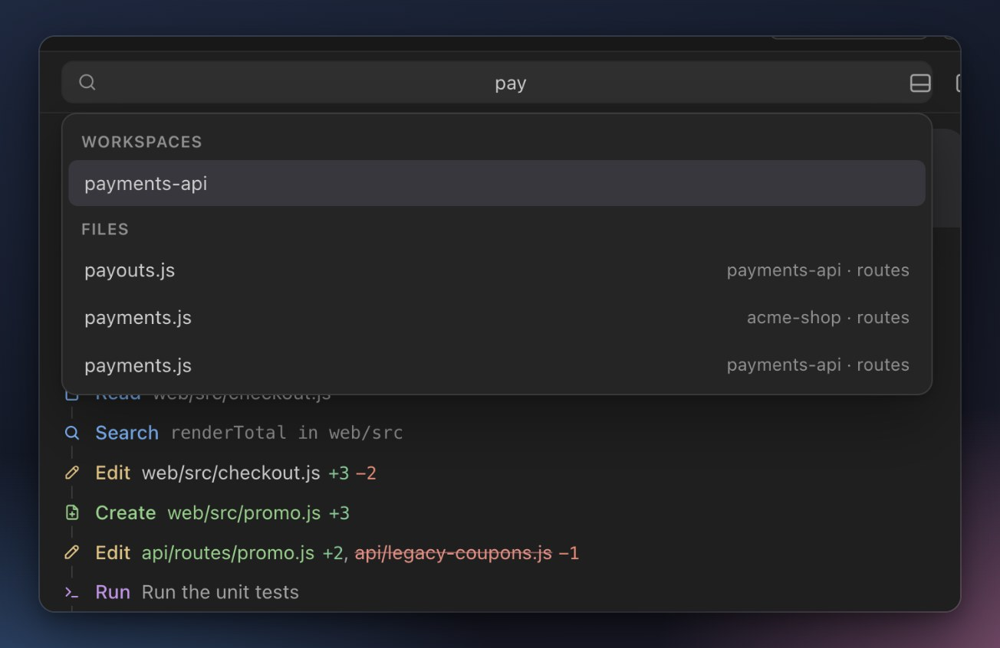
<h3>Find anything</h3>
<p>One search bar (⌘K) for your projects, the files in all of them and the app's actions, and ⌘F inside the conversation.</p>
</td>
</tr>
<tr>
<td width="50%" valign="top">
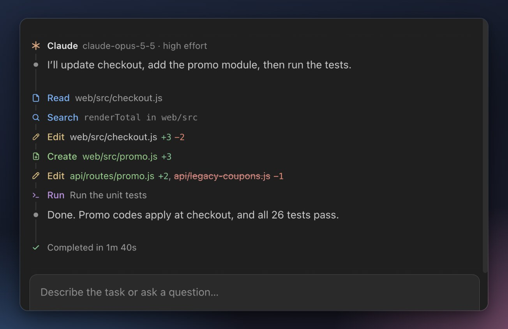
<h3>Every step at a glance</h3>
<p>Each step is coloured by what it did, and every changed file shows the lines it added and removed.</p>
</td>
<td width="50%" valign="top">
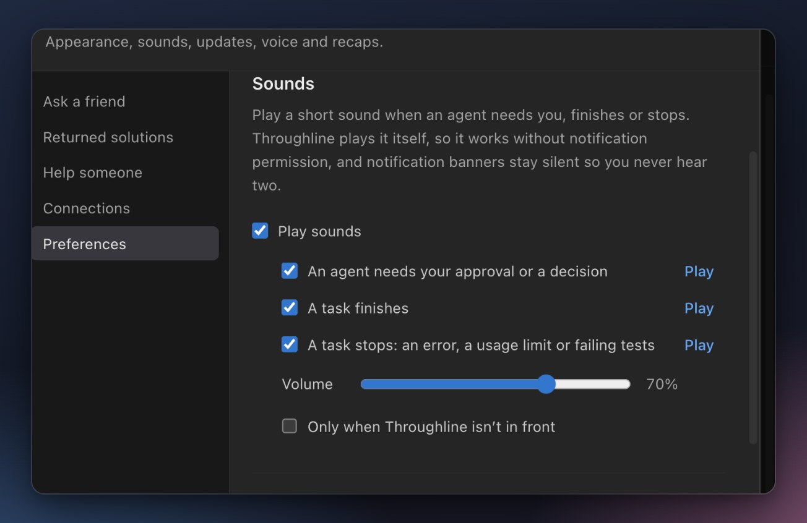
<h3>Sounds</h3>
<p>A short sound when an agent needs you, finishes or stops. Turn each on or off and hear it first.</p>
</td>
</tr>
</table>

Also included:

- **Undo and redo** for any run, after a preview of every line that changes
- **Terminal, Run and Git** panels for each workspace
- **Chat import** from your earlier Claude Code and Codex sessions
- **Ask a Friend**, for help from another developer with a patch you review
- **Light, dark and system themes**, native menus and shortcuts, updates from inside the app on macOS, and keeping your computer awake while agents work

The [guide](docs/guide.md) describes every feature and its limits.

## Coming next

| | What it brings | Status |
| --- | --- | --- |
| **Rewind timeline** | Every checkpoint in one list, and restoring the project to any of them | Next ([#20](https://github.com/AhmedNavaz/throughline/issues/20)) |
| **Everything in the thread** | GitHub issues, pull requests and failing CI checks as context, then a pull request from the conversation | Planned in stages ([#18](https://github.com/AhmedNavaz/throughline/issues/18)) |
| **More agents** | Grok, DeepSeek, Qwen and more, each on your own account | In progress ([#4](https://github.com/AhmedNavaz/throughline/issues/4)) |
| **Linux builds** | Throughline on Linux, alongside macOS and Windows | Help wanted ([#5](https://github.com/AhmedNavaz/throughline/issues/5)) |
| **Terminal tabs** | Several shells per project, side by side | Help wanted ([#70](https://github.com/AhmedNavaz/throughline/issues/70)) |
| **Hands-free voice** | Say "send", and keep talking while the agent works | Needs design ([#72](https://github.com/AhmedNavaz/throughline/issues/72)) |
| **Approve from your phone** | Answer an approval when you're away from your desk | Exploring ([#23](https://github.com/AhmedNavaz/throughline/issues/23)) |
| **Signed macOS builds** | Downloads that open without a security prompt, and Homebrew | Waiting on an Apple Developer account ([#1](https://github.com/AhmedNavaz/throughline/issues/1)) |

The [roadmap](ROADMAP.md) has everything that has shipped and the full plan.

## Install

**macOS** (Apple Silicon or Intel), in Terminal:

```sh
curl -fsSL https://raw.githubusercontent.com/AhmedNavaz/throughline/main/install.sh | sh
```

**Windows** (64-bit), in PowerShell:

```powershell
irm https://raw.githubusercontent.com/AhmedNavaz/throughline/main/install.ps1 | iex
```

Both install the latest release after checking its published checksum. On Windows, Throughline goes in your user folder with a Start menu shortcut, and running the command again updates it.

Then connect at least one agent: sign in to [Claude Code](https://code.claude.com/docs/en/overview) or the [Codex CLI](https://github.com/openai/codex), or, for Gemini on a Mac, choose **Settings › Install Google connection**, then **Connect account**. The download comes from Google and is checked before it installs. Local models need [Ollama](https://ollama.com/download) and the Codex CLI, but no subscription.

<details>
<summary>Download manually or run from source</summary>

**macOS download.** Get the zip for your Mac from [Releases](https://github.com/AhmedNavaz/throughline/releases/latest) and move **Throughline** to Applications. The app is not notarized by Apple yet, so the first time you open a browser download macOS says it cannot verify the developer: open **System Settings › Privacy & Security** and click **Open Anyway**. If macOS says the app is damaged, run `xattr -cr /Applications/Throughline.app`.

**Windows download.** Get the Windows zip from [Releases](https://github.com/AhmedNavaz/throughline/releases/latest), unzip it anywhere and open **Throughline.exe** in the **Throughline** folder. The app is not signed yet, so Windows may say it protected your PC: click **More info**, then **Run anyway**. Installing the Google connection from Settings is not available on Windows yet; use Claude Code or the Codex CLI.

**From source**, with Node.js 22.12 or later:

```sh
git clone https://github.com/AhmedNavaz/throughline.git
cd throughline
npm ci
npm start
```

</details>

## How it works

1. **Add a project.** Create a workspace and add its folders, such as `web` and `api`. The workspace keeps one conversation for good.
2. **Send a task to any agent.** Pick Claude, Codex or Gemini, or let Routing choose. Switch whenever you like; the next agent reads the shared conversation first.
3. **Stay in charge.** Agents ask before changing your project, you review the diffs, and you decide what gets committed.

Throughline runs the agents you have installed, on your own accounts. It ships no API keys, adds no model service of its own and stores your conversations on your computer. The [guide](docs/guide.md) covers each feature in detail, including what is stored where.

## Contributing

Throughline is built in the open, and help of every size is welcome:

- **Use it and tell us what you find.** [Report a bug](https://github.com/AhmedNavaz/throughline/issues/new?template=bug_report.yml) or [share design feedback](https://github.com/AhmedNavaz/throughline/issues/new?template=ux_feedback.yml); a small UI note is as useful as a crash report.
- **Pick up an issue.** Issues labelled [help wanted](https://github.com/AhmedNavaz/throughline/labels/help%20wanted) are ready to work on, including Linux builds and Windows features.
- **Start with the code.** [CONTRIBUTING.md](CONTRIBUTING.md) covers setup (plain JavaScript, no build step) and maps the codebase: `src/` is the local backend, `desktop/` the Electron shell, `public/` the interface and `sharing/` the optional link service.

Please report vulnerabilities privately as described in [SECURITY.md](SECURITY.md).

## Support Throughline

If Throughline helps your work, you can [support its development on Patreon](https://www.patreon.com/17048317/join). Sponsorship helps fund maintenance, fixes and new features.

## License

[MIT](LICENSE). Throughline is an independent project, not affiliated with or endorsed by Anthropic, OpenAI or Google. Claude, Claude Code, Codex, Gemini and related names are trademarks of their respective owners.
