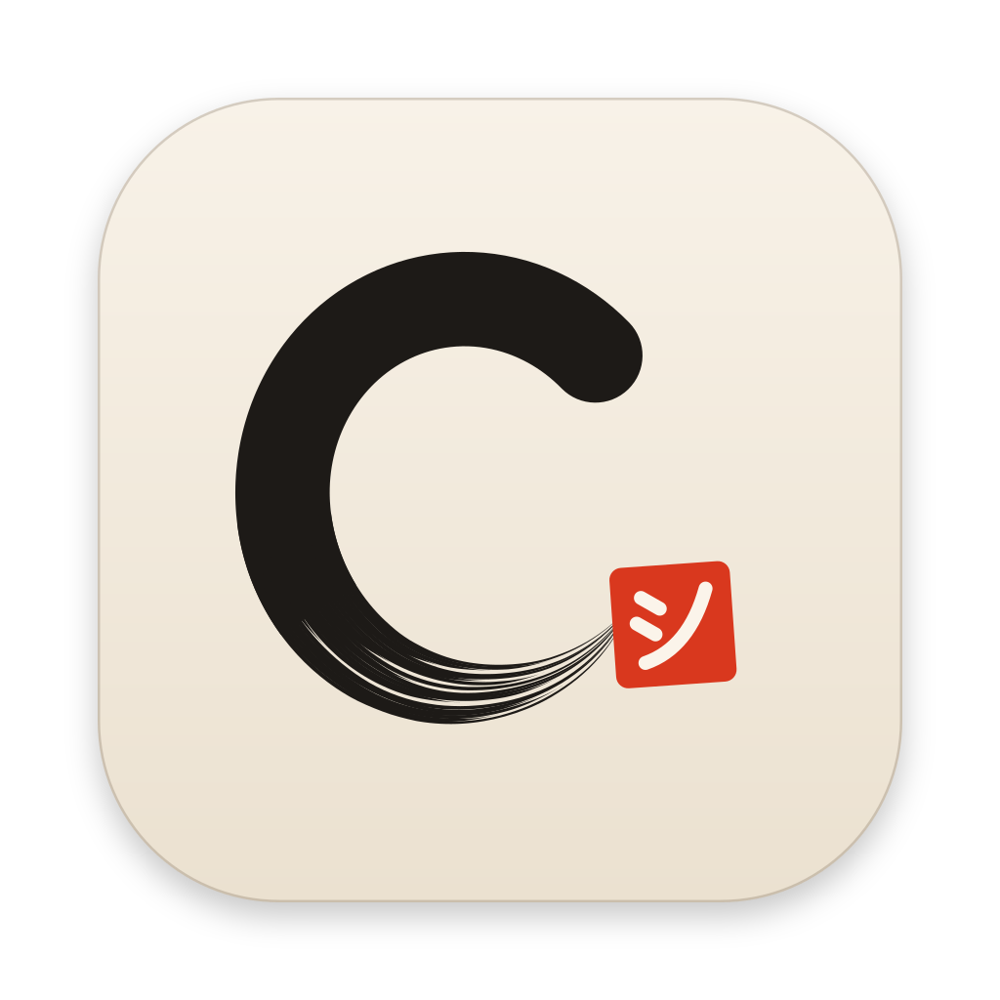

<h1 align="center"><picture><source media="(prefers-color-scheme: dark)" srcset="assets/icon-dark.svg"></picture><br>Codeshi</h1>

<p align="center"><b>Claude Code, Codex, Gemini and local models in one unified conversation.</b><br>
Automatic limit handoffs, parallel task worktrees, phone remote access, and adaptive model routing — on the plans you already pay for.</p>

<p align="center"><a href="#install-pre-built-app"><b>Install</b></a> &nbsp;·&nbsp; <a href="#run-from-source"><b>Run from source</b></a> &nbsp;·&nbsp; <a href="https://codeshi.dev"><b>Website & Demos</b></a> &nbsp;·&nbsp; <a href="docs/architecture.md"><b>Architecture</b></a> &nbsp;·&nbsp; <a href="docs/guide.md"><b>User Guide</b></a> &nbsp;·&nbsp; <a href="docs/cli.md"><b>CLI</b></a> &nbsp;·&nbsp; <a href="#contributing"><b>Contribute</b></a></p>

<p align="center"><a href="https://github.com/AhmedNavaz/codeshi/releases/latest"></a>  <a href="https://github.com/AhmedNavaz/codeshi/actions/workflows/ci.yml"></a> <a href="LICENSE"></a> <a href="https://www.patreon.com/17048317/join"></a></p>

<p align="center"><a href="https://codeshi.dev"></a><br><a href="https://codeshi.dev">See interactive walkthroughs, screenshots, and live demos at <b>codeshi.dev</b></a></p>

---

## What is Codeshi?

Every coding agent eventually hits a rate or usage limit, and switching tools usually means starting over and re-explaining your project.

**Codeshi is a free, open-source local orchestration engine and desktop app** for macOS and Windows (MIT licensed). Each workspace keeps one permanent conversation and execution environment shared across the official **Claude Code**, **Codex**, and **Gemini** CLIs, plus local **Ollama** models:

- **No API markup**: Runs against your existing personal or subscription logins (Claude Code, ChatGPT/Codex, Google/Gemini). API-billed or unconfirmed accounts require explicit confirmation and are never chosen automatically.
- **Local first**: Runs on your computer, reads your local workspace folders, and stores journals, memory, board cards, and file checkpoints locally.
- **Multi-agent resilience**: Switch agents mid-task, hand off automatically near 5-hour or weekly limits, run tasks side by side in isolated worktrees, and have another agent review finished changes read-only.

---

## Quickstart

### Install Pre-built App

**macOS** (Apple Silicon or Intel), in Terminal:
```sh
curl -fsSL https://raw.githubusercontent.com/AhmedNavaz/codeshi/main/install.sh | sh
```

macOS builds are signed ad hoc and not notarized yet ([#1](https://github.com/AhmedNavaz/codeshi/issues/1)), so macOS doesn't show **Needs you** banners for them. Until signed builds ship, choose **Panel under the menu bar** as the banner style in **Settings › Alerts**.

**Windows** (64-bit), in PowerShell:
```powershell
irm https://raw.githubusercontent.com/AhmedNavaz/codeshi/main/install.ps1 | iex
```

Both commands check the release's published SHA-256 checksum before installing. Running the Windows command again also updates an existing installation.

Or download the latest zipped releases directly from [Releases](https://github.com/AhmedNavaz/codeshi/releases/latest):

> **The first time you open a download:** Codeshi isn't notarized by Apple or signed for Windows yet, so each OS warns you once when you open a browser download. The install commands above don't show this warning.
> - **macOS** says it cannot verify the developer: open **System Settings › Privacy & Security** and click **Open Anyway**. If it says the app is damaged, run `xattr -cr /Applications/Codeshi.app`.
> - **Windows** SmartScreen may say it protected your PC: click **More info**, then **Run anyway**.

Once installed, Codeshi checks for updates and offers new versions inside the app on macOS and Windows, verifying the checksum before you restart.

### Run from Source

Codeshi has **no build step** (plain JavaScript ES modules). All you need is **Node.js 22.12+**:

```sh
git clone https://github.com/AhmedNavaz/codeshi.git
cd codeshi
npm ci
npm start        # Launches Codeshi Dev in an isolated profile
```

*For browser-only mode without Electron: `npm run web` (serves at `http://127.0.0.1:4318`).*

Connect at least one agent: sign in to [Claude Code](https://code.claude.com/docs/en/overview) or the [Codex CLI](https://github.com/openai/codex). For Gemini, open **Settings › Agents & accounts**, choose **Install Google connection**, and sign in with your Google account. For local models, install [Ollama](https://ollama.com/download) and the Codex CLI, then download any tool-capable coding model.

---

## Contributing

Codeshi is open source under the [MIT License](LICENSE) with no CLA. The best way to help right now is to try it on a real project and report what breaks ([report a bug](https://github.com/AhmedNavaz/codeshi/issues/new?template=bug_report.yml) or [share design feedback](https://github.com/AhmedNavaz/codeshi/issues/new?template=ux_feedback.yml)).

Where help is wanted:
- **Interface and docs**: fix interface details and clarify how features work in the [User Guide](docs/guide.md).
- **Accessibility and languages**: test with VoiceOver or NVDA on your project, or contribute a UI translation ([Translations](CONTRIBUTING.md#translations)).
- **Linux packaging**: help package native Linux builds; the test suite already runs on Linux in CI ([#5](https://github.com/AhmedNavaz/codeshi/issues/5)).
- **Checks on real devices**: test paid API task limits ([#87](https://github.com/AhmedNavaz/codeshi/issues/87)), moving between computers over Wi-Fi ([#160](https://github.com/AhmedNavaz/codeshi/issues/160)), or Windows in-app updates ([#163](https://github.com/AhmedNavaz/codeshi/issues/163)) and report the result.

Links for contributors:
- Open issues labelled [`good first issue`](https://github.com/AhmedNavaz/codeshi/labels/good%20first%20issue) or [`help wanted`](https://github.com/AhmedNavaz/codeshi/labels/help%20wanted)
- Setup instructions and codebase map in [CONTRIBUTING.md](CONTRIBUTING.md) and [docs/architecture.md](docs/architecture.md)
- Questions and ideas in [GitHub Discussions](https://github.com/AhmedNavaz/codeshi/discussions)
- Run the test suite (uses mock providers, no agent logins required):
  ```sh
  npm test
  ```

*Security disclosures: report vulnerabilities privately according to [SECURITY.md](SECURITY.md).*

---

## Core Capabilities

| Capability | How it works | Details |
| :--- | :--- | :--- |
| **Seamless Limit Handoffs** | Tracks 5-hour, daily, and weekly allowances. Near a limit, Codeshi offers a handoff (or switches automatically in Flow) with full brief context, or waits and resumes with **Continue when a limit resets**. | [Guide: Switching & Usage](docs/guide.md#workspaces-accounts-and-switching) |
| **The Plan** | Workspace task board in **Columns**, **Canvas**, and **Outline** beside its own **Plan chat**. Draft cards from a message or an attached document (**Draft cards**), split major cards into subtasks, accept drafts, run cards with test gates and reviews, and update the Plan from a finished card's findings. | [Guide: The Plan](docs/guide.md#models-runs-git-and-usage) |
| **Flow Mode & Routing** | Replaces the sidebar and panels with plain-language cards around the chat (**How it's working now**, **What's left on your plans**, **What's next**, **Tasks side by side**, **Smart results**, **What happened**, **Files changed**, **Your space**, **Stay connected**, and the **Lounge**). Routes prompts across **Saver**, **Smart**, and **Ultra**, runs **Check with tests**, and can split a multi-part request into parallel tasks before merging and reviewing the result. | [Guide: Flow & Routing](docs/guide.md#models-runs-git-and-usage) |
| **Parallel Task Worktrees** | Run **Tasks side by side** in the same workspace. Each task in a Git repository works in its own isolated Git worktree from the last commit (cloning `node_modules`, omitting `.env`), enforce per-folder edit boundaries, and merge back via **Review and merge** or **Resolve with an agent**. | [Guide: Parallel Tasks](docs/guide.md#models-runs-git-and-usage) |
| **Schedules** | Schedule Ready or Done cards or standalone prompts to run once, daily, on weekdays, or weekly in local time. Codeshi stays in the menu bar or notification area while a schedule is waiting, supports **Open at login**, and flags missed runs. | [Guide: Schedules](docs/guide.md#models-runs-git-and-usage) |
| **The `codeshi` Command (CLI)** | Interactive terminal session (`codeshi`) and scriptable commands (`codeshi run`, `status`, `wait`, `stop`, `continue`, `tasks` with `--json`/`--jsonl`), sharing the same conversation, approvals, handoffs, and limits as the window, plus an in-app **CLI** tab. | [CLI Reference](docs/cli.md) |
| **Remote Mobile Access** | Scan a QR code to follow live runs, approve commands, answer questions, dictate prompts, and receive lock-screen notifications from a phone browser — end-to-end encrypted away from home, or direct over the same Wi-Fi. | [Guide: Remote Access](docs/guide.md#remote-access-away-from-home) |
| **Interactive Approvals** | Default **Ask before changes** lets reads proceed and pauses edits, installs, commands, and network access for confirmation (once, for this run, or always in this workspace). | [Guide: Approvals](docs/guide.md#permission-controls-and-tool-approvals) |
| **Cross-Agent Code Review** | Request a secondary read-only review from another provider against selected file snapshots; send chosen findings back as a fix prompt. | [Guide: Cross-Agent Review](docs/guide.md#cross-agent-review) |
| **Checkpoints, Timeline & Git** | Per-run undo/redo, **Timeline** checkpoint restore with conversation rewind, local **Git activity**, staging/commits with your own hooks, and **Open pull request** via `gh`. | [Guide: Git & Timeline](docs/guide.md#models-runs-git-and-usage) |
| **Offline Local Models** | Run downloaded tool-capable Ollama models through the Codex CLI tool harness with no cloud subscription or plan usage. | [Guide: Local Models](docs/guide.md#local-models) |

Also built in: integrated **Terminal** and **Run** tabs, **Point and tell** and **Design notes** in the desktop preview, workspace **Memory** and **Skills** (**Brief** panel), on-device **Voice** dictation and hands-free conversations, [Claude Code and Codex chat import](docs/guide.md#import-claude-code-and-codex-chats), [moving between computers](docs/guide.md#move-to-another-computer) by backup file or local network, [Watch along](docs/guide.md#watch-along-with-a-teammate), and [Ask a Friend](docs/guide.md#ask-a-friend). See the full [Codeshi User Guide](docs/guide.md).

---

## The Engine Under the Hood

Codeshi coordinates disparate agent runtimes through a local Node.js orchestration server:

- **Unified Agent Protocol (`src/providers.mjs`)**: Normalizes the Claude Agent SDK, Codex app-server JSON-RPC, Gemini/Antigravity ACP, and local Ollama into one event bus for streaming steps, approvals, questions, and diffs.
- **Lossless Context Rollover (`src/task-context.mjs`)**: When switching agents or refreshing context, Codeshi builds a bounded brief from active file diffs, workspace instructions, user decisions, and unblocked tasks without relying on model-generated summaries.
- **Shadow Git Checkpoints & Mutation Leases (`src/checkpoints.mjs`, `src/mutation-lock.mjs`)**: Runs operate under filesystem leases with private Git snapshots before and after each run for previewed rollback and conflict-safe worktrees.
- **Smart Spendability Routing (`src/routing-assessment.mjs`)**: Routes prompts across **Saver**, **Smart**, and **Ultra** using request complexity, rated model tiers, and live quota spendability across every active window.
- **Autonomous Verification Loops (`src/run-checks.mjs`, `src/agent-review.mjs`)**: Runs the workspace's configured test command and independent read-only cross-agent reviews against finished changes.

See [docs/architecture.md](docs/architecture.md) for service boundaries and module ownership.

---

## Questions

### How do I keep working in Claude Code when I hit the usage limit?
Codeshi tracks your 5-hour, daily and weekly allowances. Near a limit it offers a handoff to another agent with the full brief, or waits and resumes with **Continue when a limit resets**. See [Seamless Limit Handoffs](#core-capabilities) and the [guide](docs/guide.md#workspaces-accounts-and-switching).

### How do I keep going in Codex when I hit its usage limit or weekly cap?
Codex limits work the same way: Codeshi tracks the 5-hour and weekly allowances and offers a handoff before you run out, or switches automatically in Flow. See [Seamless Limit Handoffs](#core-capabilities) and the [guide](docs/guide.md#workspaces-accounts-and-switching).

### How do I move a task from Claude Code to Codex (or back) without re-explaining everything?
When you switch agents, Codeshi builds a bounded brief from the active file diffs, workspace instructions, your decisions and unblocked tasks, so the next agent starts with the context. It doesn't rely on model-generated summaries. See [Lossless Context Rollover](#the-engine-under-the-hood) and the [guide](docs/guide.md#workspaces-accounts-and-switching).

### Can I run several coding agents on one repository at the same time?
Yes. **Tasks side by side** run in the same workspace, and each task in a Git repository works in its own Git worktree so edits don't collide. You merge back with **Review and merge**. See [Parallel Task Worktrees](#core-capabilities) and the [guide](docs/guide.md#models-runs-git-and-usage).

### Can I use Claude Code and Codex together in one conversation?
Yes. Each workspace keeps one permanent conversation shared across the Claude Code, Codex and Gemini CLIs and local Ollama models. See [What is Codeshi?](#what-is-codeshi).

### Can I use local models (Ollama) with a coding agent, and is it free?
Yes. Codeshi runs downloaded, tool-capable Ollama models through the Codex CLI tool harness, with no cloud subscription or plan usage. See [Offline Local Models](#core-capabilities), the [guide](docs/guide.md#local-models) and [Run from Source](#run-from-source) for setup.

### Can I approve what a coding agent does from my phone?
Yes. Scan a QR code to follow live runs, approve commands and answer questions from a phone browser. It's end-to-end encrypted away from home, or direct over the same Wi-Fi. See [Remote Mobile Access](#core-capabilities) and the [guide](docs/guide.md#remote-access-away-from-home).

### Does it work with my existing Claude or ChatGPT subscription, with no API keys?
Yes. Codeshi runs against your existing personal or subscription logins and supplies no API keys of its own. API-billed or unconfirmed accounts need explicit confirmation and are never chosen automatically. See [What is Codeshi?](#what-is-codeshi).

### Is there a free open-source alternative to a paid multi-agent coding app, and what does it cost?
Codeshi is free and open source under the MIT license. You pay only for the agent plans you already use. See [What is Codeshi?](#what-is-codeshi) and [License](#license).

### How do I install it on macOS or Windows, and is there a Linux version?
On macOS or Windows, run the one-line install command in [Install Pre-built App](#install-pre-built-app). There is no pre-built Linux package yet; native Linux packaging is help wanted ([#5](https://github.com/AhmedNavaz/codeshi/issues/5)), and the test suite already runs on Linux in CI. See [Contributing](#contributing).

### Why does macOS or Windows warn me when I open it, and is it safe?
Codeshi isn't notarized by Apple or signed for Windows yet, so each system warns you once when you open a browser download. The install commands don't trigger the warning. See the first-open steps in [Install Pre-built App](#install-pre-built-app) and [Limitations](docs/guide.md#limitations) in the guide.

### Can one agent review another agent's code?
Yes. Request a read-only review from another provider against selected file snapshots, then send chosen findings back as a fix prompt. See [Cross-Agent Code Review](#core-capabilities) and the [guide](docs/guide.md#cross-agent-review).

### How do I stop an AI coding agent from running commands or editing files without asking?
The default **Ask before changes** lets reads proceed and pauses edits, installs, commands and network access for your confirmation. See [Interactive Approvals](#core-capabilities) and the [guide](docs/guide.md#permission-controls-and-tool-approvals).

### Does it keep my code and chats on my computer? Is anything sent to a server?
Codeshi runs on your computer and stores journals, memory, board cards and file checkpoints locally. Remote access from a phone is end-to-end encrypted away from home. See [What is Codeshi?](#what-is-codeshi) and [Saved data and migration](docs/guide.md#saved-data-and-migration) in the guide.

### How do I import my existing Claude Code or Codex chats?
Open **Previous chats** from the search bar (⌘K) or the **File** menu, pick conversations from either agent, review them and confirm **Merge conversations**. Nothing is selected or merged automatically. See [Import Claude Code and Codex chats](docs/guide.md#import-claude-code-and-codex-chats).

---

## Status

Codeshi is early and changes quickly. Features that are built and covered by automated tests still undergo verification on real setups — see [Final checks](ROADMAP.md#final-checks) in `ROADMAP.md` and open reports under the [`bug` label](https://github.com/AhmedNavaz/codeshi/labels/bug).

---

## Experimental

Several capabilities are implemented and covered by automated tests (or rely on upstream experimental APIs), but still need verification on real projects, accounts, or devices:

- **Gemini (Antigravity ACP & Gemini CLI)**: personal Google accounts run through the pinned Antigravity ACP runtime; read-only background reviews still use Claude or Codex.
- **Flow message splits**: automatically splitting a multi-part Smart or Ultra prompt into parallel tasks and merging/reviewing the combined result.
- **Paid API task limits ([#87](https://github.com/AhmedNavaz/codeshi/issues/87))**: time, token, and API spend caps are tested with simulated providers and not yet verified on a real pay-per-use account.
- **Move over your network ([#160](https://github.com/AhmedNavaz/codeshi/issues/160))**: tested with both sides on one computer, awaiting verification between two computers on Wi-Fi.
- **Windows in-app updates ([#163](https://github.com/AhmedNavaz/codeshi/issues/163))**: tested with macOS stand-ins for the PowerShell updater, awaiting verification on a real Windows PC.
- **Claude plan usage**: read from an experimental Claude Agent SDK call and shown as unavailable if a future SDK removes it.

See [Limitations](docs/guide.md#limitations) and [Final checks](ROADMAP.md#final-checks) for details.

---

## Roadmap

Current **Now** priorities from [ROADMAP.md](ROADMAP.md):

| # | Feature | What's left | Issue |
| :---: | :--- | :--- | :--- |
| 1 | **Notarized macOS builds** | Downloads that open without a security prompt, with notification banners. Waiting on an Apple Developer account | [#1](https://github.com/AhmedNavaz/codeshi/issues/1) |
| 2 | **One Plan** | Live checks of drafting cards and running a plan with several agents | [#162](https://github.com/AhmedNavaz/codeshi/issues/162) |
| 3 | **Flow manages a whole outcome** | Live checks of a handoff between real accounts and of a split finished with real agents | [#107](https://github.com/AhmedNavaz/codeshi/issues/107) |
| 4 | **One routing policy for the whole task** | Live check of Flow handoffs between real accounts, measured model ratings, context-size checks against a model, and automatic fallback to a local model | [#12](https://github.com/AhmedNavaz/codeshi/issues/12) |
| 5 | **Specialist roles** | Stricter contract-first ordering, machine-readable events with distinct outcomes, and a measured comparison with one agent | [#89](https://github.com/AhmedNavaz/codeshi/issues/89) |

See [ROADMAP.md](ROADMAP.md) for **Next**, **Later**, **Final checks**, **Ongoing checks**, and **Exploring**, and [CHANGELOG.md](CHANGELOG.md) for shipped releases.

---

## Support

Codeshi is free and open source, under the MIT license. If it saves you time, you can support ongoing development:

- [Patreon](https://www.patreon.com/17048317/join)
- [Buy Me a Coffee](https://www.buymeacoffee.com/codeshi)

Funding goals:

- Code signing for the macOS and Windows builds, which removes the first-open warnings described under [Install Pre-built App](#install-pre-built-app).
- Usage costs for testing against the real Claude Code, Codex and Gemini CLIs.
- Maintainer time for issues, reviews and the [roadmap](ROADMAP.md).

---

## License

[MIT License](LICENSE) · Built independently. Not affiliated with or endorsed by Anthropic, OpenAI, or Google.
