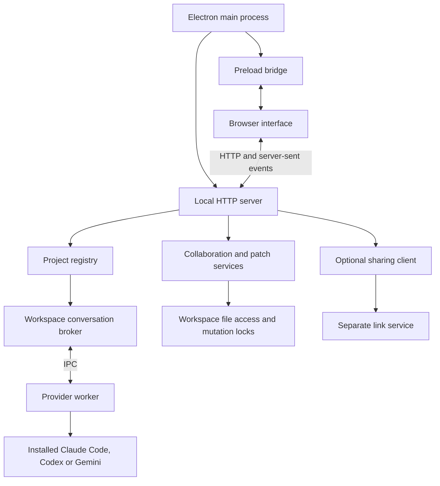
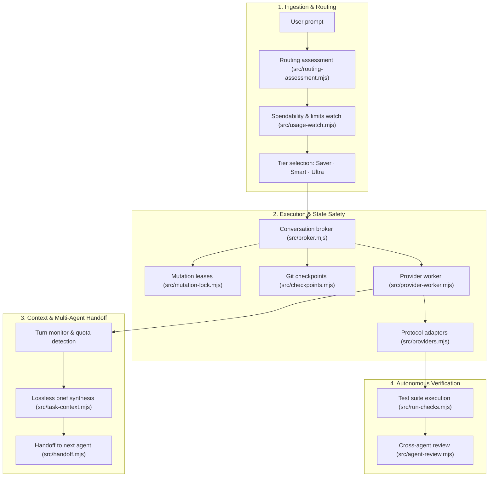

# Architecture

Codeshi is a local desktop application: an Electron shell, a Node.js HTTP server and a static JavaScript interface. There is no frontend build step. The optional sharing service runs separately and handles Ask a Friend links.

## Runtime boundaries



`src/server.mjs` creates and connects services, applies request checks and dispatches routes. Domain modules take explicit dependencies; they do not import the server or Electron. The desktop main process owns server startup and shutdown. The interface has no direct Node.js or filesystem access.

| Area | Owner |
| --- | --- |
| Desktop lifecycle, native dialogs and trusted IPC | `desktop/main.mjs`, `desktop/preload.cjs` |
| App-version announcements and bundled changelog entries | `desktop/updates.mjs` |
| Isolated background review workers and immutable selected-file copies | `src/review-jobs.mjs` |
| Per-prompt build-to-review authorization, bounded capture and journalled phases (#15) | `src/automatic-review.mjs`, `src/automatic-review-runs.mjs` |
| Downloaded local-model discovery, validation and scoped launch routes | `src/local-models.mjs` |
| Temporary development profiles and data migration | `desktop/launch.mjs`, `desktop/storage.mjs` |
| Workspace identity, folders and one permanent conversation | `src/projects.mjs` |
| Conversation journal, accepted submissions, approvals and run lifecycle | `src/broker.mjs` |
| Run checkpoints in a private Git object store per folder, previewed undo/redo and Timeline restore with durable recovery (#20) | `src/checkpoints.mjs`, `src/checkpoint-routes.mjs` |
| An agent's questions with options: Claude's AskUserQuestion and Codex's request_user_input in one shape, answer checks, and the card where they are answered | `src/agent-questions.mjs`, `public/questions.js` |
| Alert settings (each way on or off, for each moment), where each alert goes, and which sound the page plays from the `alert` event | `src/alerts.mjs` |
| Waiting for a usage limit to reset and continuing on the first agent with room (#32) | `src/resume.mjs` |
| Loopback relay that reaches Google over IPv4 first for the Antigravity runtime, and carries the agent's commands during a run | `src/google-relay.mjs` |
| Shared prompt context | `src/context.mjs` |
| Agent protocol adapters and worker entry point | `src/gemini.mjs`, `src/providers.mjs`, `src/provider-worker.mjs`, `src/resolve-binary.mjs` |
| Review snapshots, validated findings, freshness and review HTTP routes | `src/agent-review.mjs`, `src/agent-review-routes.mjs` |
| History discovery, reviewed imports and portable exports | `src/conversation-routes.mjs`, `src/conversation-import.mjs`, `src/conversation-export.mjs` |
| File, attachment and Git HTTP routes | `src/workspace-routes.mjs` |
| Filesystem boundaries, baselines and mutation coordination | `src/workspace-files.mjs`, `src/workspace-layout.mjs`, `src/workspace-baseline.mjs`, `src/mutation-lock.mjs` |
| Reviewed collaboration packages and returned patches | `src/collaboration*.mjs`, `src/patches.mjs`, `src/sharing-client.mjs` |
| Independently deployable private-link storage and HTTP service | `sharing/` |

## Repository layout

```text
src/        Local server, workspace services, agent adapters and provider worker
desktop/    Electron lifecycle, preload bridge and packaging tools
public/     Browser interface and static assets served by the local server
sharing/    Independently deployable private-link service and its tests
test/       Application tests and mock agents
assets/     Shipped branding and application icons
docs/       Architecture, user guide and screenshots
```

The local backend lives in `src/` so the repository root stays focused on project information, package configuration and the public installer. This is a source-directory convention, not a Node.js requirement: [npm supports explicit entry points and scripts](https://docs.npmjs.com/cli/v11/configuring-npm/package-json/). The directories above follow the application's existing runtime and deployment boundaries. Source modules retain explicit imports and dependencies; this layout adds no build step or framework. Split modules or introduce feature subdirectories when their responsibilities require it.

`src/server.mjs` resolves static assets and the default development `.data/` directory relative to the application root, independent of the working directory. Moving source files must not move saved history. `src/broker.mjs` locates its sibling provider worker relative to its own module URL, so worker startup also works from a packaged app or another workspace. The sharing container copies only its service, public assets and the portable format module from `src/`.

Disposable generated assets belong in `output/`, which is excluded from Git and desktop packages.

## Interface ownership

`public/app.js` owns workspace selection, conversation state, the composer, requests and the live event connection. It exposes `window.relayUI`; feature scripts use that API and listen for `relay-state` rather than keeping separate copies of the active workspace or conversation.

| Feature script | Responsibility |
| --- | --- |
| `insights.js` | Model and effort controls, run progress, account usage and Git activity |
| `conversation-history.js` | Previous-chat discovery, selection, review, merge and export |
| `setup.js` | Onboarding and saved preferences; announces `relay-setup-ready` after initial setup state loads |
| `updates.js` | In-app release notes after updates and from Help; waits for setup and workspace loading |
| `model-picker.js` | Searchable cloud/local selection, workspace-scoped catalog requests and normal composer integration |
| `local-models.js` | Explicit local-model selection, task handoff and setup guidance |
| `files.js` | File explorer, previews and attachments |
| `conversation-search.js` | Find in the conversation: match highlights, the match count and moving between matches |
| `agent-review.js` | Cross-agent review selection, explicit preview/start, findings and fix drafts |
| `automatic-review.js` | One-prompt review consent, scope selection and build/review phase status |
| `rewind.js` | A run's checkpoint line, the Timeline panel, and undo/redo/restore previews |
| `alerts.js` | Alert sounds made with Web Audio, and channel/event controls on the Alerts page of Settings |
| `settings.js`, `settings.css` | Searchable Settings dialog with General, Accounts, Alerts and Voice pages; a shared row/group kit used by feature modules |
| `workbench.js` | Separate Ask a Friend dialog and review flow, plus pending approval and question cards |
| `desktop-controls.js` | Native keep-awake controls |

Settings owns app-wide preferences and account connections, while the composer and Agents panel retain conversation-specific model, access and routing choices. General contains appearance, Keep awake, global handoff preferences and updates; Accounts contains connection, usage and session billing consent; Alerts contains channels and return recaps; Voice contains input and read-aloud choices. Feature modules (`updater.js`, `alerts.js`, `recap.js` and `voice.js`) render their controls through the Settings kit so rows have consistent labels, descriptions and controls. Search filters settings across pages. Ask a Friend has its own dialog; workspace folders and remembered approvals remain in Workspace settings.

The deferred scripts in `index.html` load the core API before its features, and history before setup can announce readiness. New scripts and styles also need an entry in the server's explicit static-asset allowlist. Interface tests exercise the actual scripts; HTTP tests check that the page's scripts and styles are served.

## Orchestration engine architecture

Under the surface, Codeshi coordinates multiple independent AI coding tools through five interconnected engine systems:



### 1. Unified agent protocol normalization
Claude Code, OpenAI Codex, and Google Antigravity (ACP) use incompatible execution models (Claude Agent SDK vs. JSON-RPC tool loops vs. ACP protocol streams). `src/providers.mjs` and `src/provider-worker.mjs` normalize these into a unified event contract:
- **Event normalization**: Run lifecycle events (`start`, `step`, `output`, `tool_call`, `tool_result`, `diff`, `complete`, `error`) and approval gates are abstracted away from vendor-specific CLI payloads.
- **Worker process isolation**: Agent invocations execute in an isolated worker process. Process crashes, out-of-memory errors, or runaway tool loops cannot take down the desktop server or corrupt local journals.
- **Tool harness virtualization**: The local engine enforces permission policies, shell execution boundaries, and workspace directory sandboxing directly, rather than relying on third-party CLIs to guard local files.

### 2. Lossless context rollover and multi-agent handoffs
Switching between models or maintaining long conversations often causes context amnesia or token bloat. Codeshi avoids lossy AI chat summarization:
- **Task brief distillation (`src/task-context.mjs`, `src/context-rollover.mjs`)**: Codeshi synthesizes an intent-first envelope containing the initial task goal, substantive user instructions, active git modifications, unblocked tasks, and decision history.
- **Provider-agnostic handoffs (`src/handoff.mjs`)**: When an agent hits a token ceiling or quota limit, the incoming agent receives an authoritative brief with historical evidence clearly separated from instructions. The incoming agent inspects real files rather than trusting hallucinated chat summaries.

### 3. Shadow Git checkpoints and mutation leases
Concurrent agent executions and background tasks can overwrite each other without strict synchronization:
- **Filesystem mutation leases (`src/mutation-lock.mjs`)**: Any coding or review run must acquire a tracked mutation lease for the target workspace folders, preventing conflicting edits between parallel runs.
- **Private Git checkpoints (`src/checkpoints.mjs`)**: Before and after every tool execution or run, Codeshi snapshots directory states in a private Git object store. This powers previewed undo/redo, timeline scrubbing, and risk-free rollback of failed agent edits.
- **Worktree task isolation (`src/task-isolation.mjs`)**: Side-by-side tasks run in dedicated Git worktrees, allowing multiple agents to code concurrently without working-tree collisions, followed by interactive conflict-checked integration.

### 4. Smart spendability routing
Codeshi's routing engine (`src/routing-assessment.mjs`, `src/usage-watch.mjs`) selects the optimal agent, model, and reasoning effort:
- **Rule & heuristic assessment**: Scores prompt complexity (typo vs. isolated bug vs. architectural refactor), affected files, and context depth.
- **Live spendability tracking**: Monitors reset windows and quota burn rates across accounts, dynamically choosing between **Saver** (local rules, quota conservation), **Smart** (balanced model & effort matching), and **Ultra** (maximum reasoning models with deep passes).

### 5. Autonomous verification and review loops
Reliability requires checking agent work before human review:
- **Automated test execution (`src/run-checks.mjs`)**: Executes targeted test commands upon task completion, capturing regressions.
- **Independent cross-agent reviews (`src/agent-review.mjs`, `src/automatic-review.mjs`)**: In Ultra mode or explicit review configurations, a second model reviews the first model's diffs in a sandboxed, read-only session, reporting structured findings with file line links before notifying the user.

## State and operations

Each workspace has a stable ID, attached folder records and one permanent conversation ID in `projects.json`. Conversation events live in per-workspace JSONL journals; reopening a workspace replays those events. Preferences live in `settings.json`. Electron keeps this data under its user-data directory; browser-only development uses `.data/` by default. CLI credentials remain managed by the installed agents. The guide describes the user-facing storage and migration behavior.

### Permission policies and tool approvals

Codeshi tracks two explicit permission policies: `ask` (default) and `auto` (Full auto-approval).
- Policy validation: `checkSettings(provider, mode, approvalPolicy)` in `src/broker.mjs` ensures that only valid policies (`ask`, `auto`) are accepted. Combining `mode === 'read'` with `approvalPolicy === 'auto'` is strictly incompatible and rejected with a 400 permission error.
- Workspace scoping: Every new conversation defaults to manual permissions (`approvalPolicy: 'ask'`). Policy changes are recorded in the workspace journal. Importing external transcripts or conversations never copies or overrides the permission setting.
- Run lifecycle and immutability: When a run starts, its `approvalPolicy` is captured in the submission record and bound to `run.approvalPolicy`. In-flight runs retain their policy regardless of subsequent settings changes. Existing pending requests retain their current policy.
- Auto-approval handling: In `run.approvalPolicy === 'auto'`, tool approval requests emitted over worker IPC are approved automatically by the broker, emitting an activity log to the conversation. Provider adapters (`runCodex`, `runClaude`, `runGemini`) allow tool execution directly without manual user confirmation. Read-only mode denies tool execution regardless of approval policy.

A submitted message carries a request ID so retrying after a lost response does not run the same task twice. The broker records the submission, starts a provider worker and turns worker events into journal entries and live updates. The UI refreshes the corresponding workspace and rejects stale responses after selection changes.

Google personal accounts use the official Antigravity ACP runtime (1.4.5+), installed explicitly from Google’s pinned archive with a verified checksum. Both the server and matching harness are kept in the application data folder, with an isolated `GEMINI_HOME` profile. The runtime owns personal OAuth; ambient API keys, ADC and Antigravity bypass variables are removed. Metadata sessions in an empty app-owned folder read account/model/effort information without prompts; the account and model checks share one runtime start, and a signed-in result is reused for a minute. The runtime reaches Google through a loopback relay (`src/google-relay.mjs`) because some networks stall TLS to Google over IPv6 and the runtime never falls back: the relay accepts only token-authenticated `CONNECT` tunnels to Google hosts on port 443, connects over IPv4 before IPv6, never sees inside the TLS stream, and steps aside when the user has configured a proxy. Each coding session confirms the `default` approval mode and requested model/effort before sending; only one-time tool approvals are granted. User questions are rejected instead of being treated as tool approvals. Antigravity’s native workspace-trust and hooks remain active; it does not expose a verified read-only mode in this connection, so read-only work and background reviews use Codex or Claude. Plain headless `agy` remains blocked. Gemini CLI 0.66.0+ is retained as an explicit advanced API/enterprise connection using isolated per-run policy, restricted read tools, one-time edits/commands and workspace-bounded text-file proxies. No authentication, billing or entitlement is inferred from cached account names or invented model lists.

Continue locally uses Codex as the tool harness and Ollama as the model provider. Its dedicated route validates the approved workspace, access mode and downloaded-model digest. Internal broker options select a fresh local run without changing cloud settings or sessions; ordinary message bodies cannot enable them. The adapter rechecks local model metadata, pins the loopback Responses endpoint, requires the native client to confirm the local provider before sending a task, disables hosted search/MCP and provider telemetry for this invocation, and retains native approvals, cancellation and mutation leases. The application journal remains canonical; local Codex threads are ephemeral. Reply metadata and conversation exports retain local-model attribution.

Cross-agent reviews reuse that same run lifecycle, workspace mutation lease, billing gate, cancellation and provider adapters. Review requests are created by the dedicated route module; ordinary message bodies cannot enable the broker's internal review options. A review forces read-only access and a fresh provider session, preserves coding preferences, and never stores or advances the provider's normal coding session. The journal stores the selected diffs and their file-content/Git-base identities with the review submission, then a validated result record. Snapshot validation is repeated after acquiring the mutation lease. Review callbacks deny write/command approvals; existing native provider read-only policies remain in force.

Optional automatic review authorizes a future scope rule for a single coding prompt. The preview digest binds the full task, immutable attachment identities, saved brief, builder/reviewer models, permissions and attached folder identities. The broker validates it before accepting the submission. After a successful build and configured test checks, it captures eligible uncommitted text changes under a mutation lease and starts the ordinary snapshot review job. Scope overflow stops instead of silently choosing a subset. The saved brief is copied into the review worker, and main-journal process ownership is persisted before its provider can launch. Each phase is journalled against the builder run and appears in its activity; recovery marks unfinished sequences interrupted without launching anything. A queue latch prevents queued work bypassing the review, and completion pauses the queue for the user. Findings use the existing freshness and selected-fix-draft path; there is no automatic fix or review loop. Quota handoffs require an explicit choice during these runs, and material task changes revoke the review authorization.

Review findings must parse as a bounded JSON report with known severities, selected-file identities and valid line numbers. Invalid reports stay explicitly unstructured. Conversation responses expose compact review metadata; the scoped review endpoint supplies captured diffs and checks freshness. Fix preparation accepts finding IDs from a completed, current review and returns a draft without starting a provider. The interface uses text nodes for all agent-supplied review content and guards responses against workspace changes.

The registry coordinates workspace membership and brokers. File guards protect registry writes, project locks protect conversation ownership, and mutation leases prevent conflicting agent and patch operations on overlapping folders. New guards record PID/start identity in unique owner-marker filenames. A recovery process must atomically claim the exact dead owner’s marker before retiring its directory; competing recoverers cannot remove a replacement guard. Live owners are never expired by age, and empty legacy or unrecognized guards remain fail-closed. Shutdown waits for brokers and active mutations before releasing their locks.

Git-panel writes in `src/workspace-commit.mjs` also take durable mutation leases. Their scope is the canonical Git working-tree root, so a nested folder's index action excludes a sibling-folder run, patch, import, restore or integration. Different worktrees retain separate index leases. The low-level functions default to the shared coordinator; routes inject the registry's tracked mutation wrapper so shutdown waits for asynchronous hooks. Membership and repository identity are checked again before writes. Tracked mutation completion reconsiders waiting tasks across open workspace brokers, since the blocker may have been a Git action rather than a provider run.

Context envelopes use an intent-first byte budget in `src/context.mjs`. Current input and manual context are validated before inference. The first substantive user request and eight latest substantive instructions are protected before selecting assistant text; generated Continue requests do not displace task intent. Tool activity is allocated at most a small fraction of the envelope and uses explicit head/tail excerpts. Selection preserves chronological order and full journals, budgets JSON escaping and UTF-8, and reserves image-index space before selecting history. Run context metadata records inclusion, omission, shortening and session provenance. No model call is made to summarize history.

Consecutive same-agent turns may resume a current Codex/Claude native session with unseen shared messages. After another provider or a local run, explicit Continue, or folder membership changes, the broker reconstructs a fresh session from the canonical journal and resets the incoming provider's stale checkpoint only after accepting the submission. Gemini continues its own ACP session when its runtime reports that it can resume one; a saved session the runtime no longer has fails that run, is dropped, and the next message starts fresh. The handoff envelope identifies the previous run's provider, status and failure category; these are historical evidence, and the incoming agent must inspect current files. Read-only, billing and permission checks stay independent of session selection.

History discovery reads metadata. Selecting a source loads a preview; merging rechecks its approved digest and records the selected text without starting an agent. Source IDs prevent duplicate imported messages. Export defaults remove possible secrets and local paths. Collaboration similarly keeps review, approval and patch application explicit.

## Extending the app

Add agent protocols through `src/providers.mjs` and the worker, retaining the broker's normalized events, approvals, cancellation and journal semantics. Keep new HTTP features behind the existing server checks and pass their dependencies into a dedicated route module.

[Project command controls](https://github.com/AhmedNavaz/codeshi/issues/47) (`src/project-commands.mjs`) and the [workspace terminal](https://github.com/AhmedNavaz/codeshi/issues/7) (`src/terminal.mjs`) own their processes in the same way: each resolves the workspace and folder through the registry, starts its process in its own group, keeps its sessions while the panel is hidden or another workspace is open, and stops the whole process tree when a session ends, its workspace is removed or the app quits. The terminal keeps up to eight sessions per workspace, each addressed by its own id and refused to any other workspace; each session records its tab and its place in that tab, so the page rebuilds the same tabs and split panes after a reload ([#70](https://github.com/AhmedNavaz/codeshi/issues/70)). Neither takes the editing lease, so a dev server keeps running while agents edit files. A workspace's commands are saved by name in `commands.json` in its data folder (a file from before named commands, with one Run and one Test command, is read as two commands of those names); one can be marked for Check with tests, which starts it through the registry like any other. Their output is kept as the program wrote it, colours included, and the page draws only colour and weight codes from it, as text. Both tools are tabs of one bottom panel, whose state the page keeps.

The [Point and tell](https://github.com/AhmedNavaz/codeshi/issues/19) preview (`desktop/preview.mjs`) is a separate window of two views: a toolbar the app trusts, with a preload that can only send toolbar actions, and the page, in its own session partition. The page view accepts local addresses only (other links go to the browser), opens no windows, cancels downloads and is refused every permission. Its picker (`desktop/preview-page-preload.cjs`) runs in the page's isolated world, so the page's scripts cannot reach it, and it exposes nothing to the page. A pick reports the element as plain data, a one-time mark on the element, and its position on screen. The main process captures that area of the page and asks the page's own world, once, what its framework knows about the marked element (React's debug source or stack, Vue's component file, Svelte's element location); every value is cleaned, bounded and turned into a sentence the person reads before sending, and file paths are kept only when they are inside the workspace. The terminal runs the person's login shell in a pseudo-terminal from `node-pty` (Node-API prebuilt binaries for Apple Silicon and Intel, so it needs no compiler and loads in both Node and Electron) and renders it with xterm.js, served from the installed packages. Output reaches the page over a server-sent event stream that resumes from its last offset, and input and resizes are posted to the session they belong to; the page is never given Node.js access. xterm.js adds its own `<style>` elements, so each page load gets a nonce in the Content Security Policy that allows exactly those instead of inline styles in general.

Voice input (`src/voice.mjs`) runs **Codeshi Speech** (`native/macos/speech`), a small Swift helper that records the microphone and transcribes with Apple's on-device recognizer, writing JSON lines that the page follows as a server-sent event stream; one listening session runs at a time. The helper relaunches itself as its own responsible process so macOS asks for permission with the usage descriptions embedded in it, which also works when running from source, where it is built on first use. On Windows the helper is `native/windows/speech`, a small C# program that speaks the same protocol with the offline recognizer in .NET's System.Speech; it is built with the C# compiler that is part of Windows, so it needs no extra tools. Packaging builds the helper for the target system and architecture, and the packaged-app smoke test runs its `--check`. Spoken summaries are assembled in the page from the run's recorded steps and spoken with the system's speech synthesis, so they need no agent call.

For changes, run `npm test` and `npm run test:desktop`. Tests use temporary folders and mock agents. Add coverage for state transitions and process cleanup when those behaviors change; tests must not use live accounts or saved user history.

Background review routes explicitly opt into a separate broker and private snapshot directory. Canonical review records and request fingerprints remain in the workspace journal; normal coding sessions and last-run state are independent. Snapshot jobs have their own Stop action, a bounded global count and shutdown cleanup. They also occupy workspace worker slots. Usage samples are persisted as `review_budget` records on the parent task, and a parent budget monitor enforces its shared deadline, token and API-spend thresholds against the worker. The worker's native API cap reads the parent's remaining allowance. An active journal entry reserves the remaining measured allowance exclusively for that task, so two workers cannot receive it; tasks without measured limits retain concurrent reviews. Completed review usage cannot change the builder's native session baseline, and recovery retains the last saved sample. Folder removal/membership checks reject active reviews before persisting changes. Worker events publish phase/tool-count progress; report freshness always checks the live source before preparing fixes. Only approved selected files are copied, and raw responses are bounded. Legacy direct review calls retain their existing behavior.

Google account quota is read through the pinned official ACP runtime’s built-in `/usage` handler, which intercepts the command before agent inference. The reader uses an empty metadata workspace, denies tool requests, bounds the report and declines unverified runtime versions. Native quota groups and buckets are parsed independently from session token usage; missing data never creates percentages. Cache keys include the executable and Google profile, and account connect/disconnect invalidates the cache.
